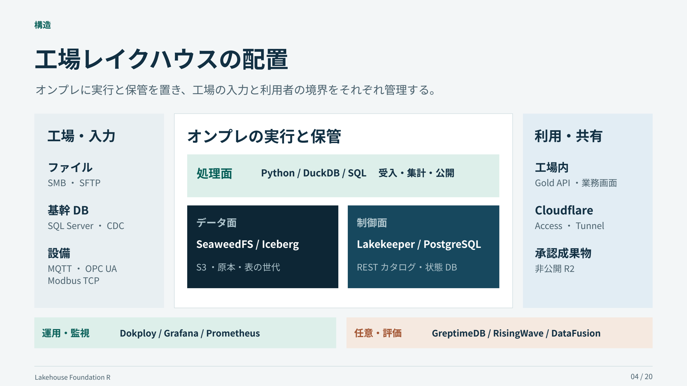

# Lakehouse Foundation R

<!-- doc-purpose:start -->
> **役割:** JVMを使わない標準構成と会社VMでのDokploy配備の入口を確認します。
>
> **対象読者:** 初めて使う人 / 基盤構築担当
>
> **読むタイミング:** 導入の方法を選ぶとき。
>
> **前提となる資料:** なし。必要な用語は本文で確認します。
>
> **次に読む資料:** [Foundation Rの初回導入と操作](<docs/native/START.md>) / [会社VMの受入手順と合格条件](<docs/native/ACCEPTANCE.md>)
>
> **文書一覧:** [目的・読者から探す文書マニフェスト](<docs/DOCUMENTATION-MANIFEST.md>)
<!-- doc-purpose:end -->

MES・ERP・設備の入力原本を保管し、工場別の日次生産、出荷の充足状況、設備の最新値と1分集計を提供するデータレイクハウスです。標準構成は、JVMを使わずに1台のLinux VMで動きます。

[プレゼン用PNG（2400×1350）](docs/native/images/foundation-r-structure.png) · [編集できるPowerPoint](docs/native/PRESENTATION.md) · [データ経路の説明図](docs/native/images/foundation-r-overview.html) · [技術の役割と採用理由](docs/native/ARCHITECTURE.md)

## 会社VMでDokployから配備する

Dokployの **Projects → Create Service → Compose** から、公開GitHubの `main` と `compose.yaml` を指定します。配備先VMで生成した非公開設定を **Environment** へ登録し、**Deploy** を実行します。

[最初からDokployで配備する手順](docs/native/START.md) · [会社のプロキシ・CA、追加構成](docs/native/COMPANY.md) · [会社VMの受入条件](docs/native/ACCEPTANCE.md)

## やりたいことから探す

| やりたいこと | 手順 |
| --- | --- |
| GUIから配備する、会社のプロキシ・CAを設定する | [Dokployと企業ネットワーク](docs/native/COMPANY.md) |
| ブラウザーで公開した集計を確認する | [集計結果の確認と接続先一覧](docs/native/GUI.md) |
| 同じGoldをNotebookで調査する、工場ごとのKPIを探索する | [marimoの日次生産](examples/marimo/README.md) · [Rillの工場別KPI](examples/rill/README.md) |
| アプリの状態を見る、ダッシュボードを変更する | [Grafana運用監視](docs/native/MONITORING.md) |
| ファイル、PostgreSQL、SQL Server、SQLite、外部Kafkaを接続する | [入出力契約と接続方法](docs/native/SOURCES.md) |
| 工場のMQTT計測と停止中の再送を試す | [設備テレメトリの接続と受入](docs/native/TELEMETRY.md) |
| 自動化・調査・時系列を追加する | [n8n、OpenObserve、InfluxDB、運用ポータル](docs/native/TOOLS.md) |
| 導入と運用を説明する | [説明スライドとPowerPoint](docs/native/PRESENTATION.md) |
| オンプレのGoldをCloudflare Accessで提供する | [オンプレとCloudflare](docs/native/CLOUDFLARE.md) |
| GoldをアプリやLangChainから参照する | [APIとLangChain](docs/native/API.md) |
| 障害を切り分ける、会社VMで受入試験を行う | [運用とバックアップ](docs/native/OPERATIONS.md) · [受入手順と合格条件](docs/native/ACCEPTANCE.md) |
| 設計判断と評価状況を確認する | [構成と採用理由](docs/native/ARCHITECTURE.md) · [レイクハウスの設計思想](docs/native/DESIGN.md) · [構想と実装の対応](docs/native/ROADMAP.md) · [比較試験](docs/native/EVALUATION.md) |

## リポジトリの構成

| 場所 | 内容 |
| --- | --- |
| `native/` | API、取込、S3とカタログの接続、DuckDBの変換、任意の閲覧UI、監視設定 |
| `medallion/` と `contracts/` | 取り込めるファイル、業務SQL、期待値、契約の固定ハッシュ |
| `infra/` | CDCの状態管理、PostgreSQLとSQL Serverの接続例、ビルドで使うCA処理 |
| `scripts/` と `tests/` | 合成データ、ホスト側の抽出・検査、単体とComposeの受入試験 |

[変更と検証の手順](CONTRIBUTING.md) · [公式リファレンスと採用バージョン](docs/native/REFERENCES.md)
