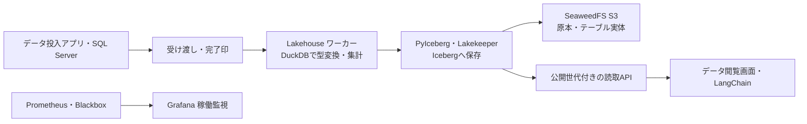

# Lakehouse Foundation R

<!-- doc-purpose:start -->
> **役割:** JVMを使わない標準構成の機能と導入入口を確認します。
>
> **対象読者:** 初めて使う人 / 基盤構築担当
>
> **読むタイミング:** 導入の方法を選ぶとき。
>
> **前提となる資料:** なし。必要な用語は本文で確認します。
>
> **次に読む資料:** [Foundation Rの初回導入と操作](<docs/native/START.md>)
>
> **文書一覧:** [目的・読者から探す文書マニフェスト](<docs/DOCUMENTATION-MANIFEST.md>)
<!-- doc-purpose:end -->

MES・ERPのファイルとSQL Server由来のイベントを取り込み、Apache Icebergへ保存する単一ホストのデータレイクハウスです。標準起動はJVMなしで動きます。既存Foundationの機能は [互換構成ガイド](FOUNDATION.md) にあります。

## 全体構成



DuckDBはワーカーに組み込む分析用SQLエンジンです。変換時にメモリ上で起動し、PyIcebergが結果を保存します。製品ごとの責務やCDCの経路は [詳細構成](docs/native/ARCHITECTURE.md) にあります。

| 必要な機能 | Foundation Rの入口 |
| --- | --- |
| 原本、CSV・JSONL・画像の取り込み | SeaweedFS S3、SHA-256完了印、Icebergの取込台帳 |
| Silver・Quarantine・Gold | DuckDB、PyIceberg、Lakekeeper。既存6ソースの業務SQLと期待値を使用 |
| SQL ServerとKafka | 固定SQLバッチ再生、外部Kafka互換ブローカーからの任意CDC |
| 設備時系列 | CSV等と同じlandingからJSONLを受け、履歴・最新値・1分窓をIcebergへ保存 |
| Web閲覧・AI連携 | StreamlitのGold閲覧、Lakekeeper・Prometheusの管理画面、読取API、LangChainツール |
| アプリ稼働監視 | Prometheus、Blackbox Exporter、Grafana。監視先とパネルは設定ファイル |
| Superset、JupyterLab、MCP、Spark、Airflowなど | 既存の別Compose構成と既存手順 |

## 最初に起動する

企業ネットワークからは先に [プロキシとCA](docs/native/COMPANY.md) を確認してください。GitHubでは、この非公開リポジトリを読めるアカウントで認証します。

**Bash / Zsh共通**

```bash
git clone https://github.com/hiromura16/lakehouse-foundation-R.git
cd lakehouse-foundation-R
python3 native/setup.py
site="$HOME/.config/lakehouse-foundation-r/site.env"
chmod -R a+rX native/monitoring
docker compose --env-file "$site" config --quiet
docker compose --env-file "$site" up -d --build --wait --wait-timeout 180
docker compose --env-file "$site" exec -T lakehouse python -m native.api verify
```

`verify` は専用の一時Iceberg namespaceで、元の6ソースの合成データと期待値を照合します。実際にlandingへファイルを置いてGoldを作る手順は [初回導入と操作](docs/native/START.md) にあります。Dokployを使う場合は [Dokployと企業ネットワーク](docs/native/COMPANY.md) を参照してください。

- [設計、データ契約、元のFoundationとの比較](docs/native/ARCHITECTURE.md)
- [データ閲覧・管理画面を追加する](docs/native/GUI.md)
- [設定ファイルで変更する稼働監視](docs/native/MONITORING.md)
- [Kafka / SQL Server / データ投入アプリ](docs/native/SOURCES.md)
- [APIとLangChain](docs/native/API.md)
- [バックアップ、障害対応、検証](docs/native/OPERATIONS.md)
- [公式リファレンスと採用バージョン](docs/native/REFERENCES.md)
