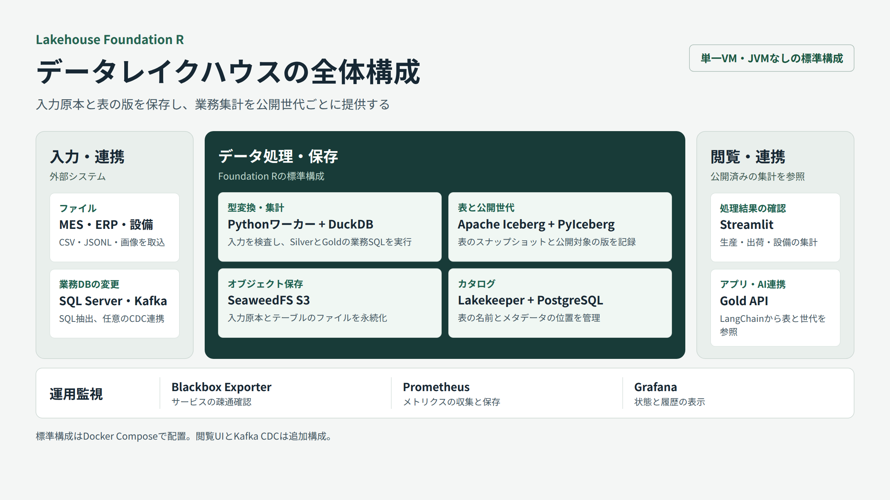

# Lakehouse Foundation R

<!-- doc-purpose:start -->
> **役割:** JVMを使わない標準構成の機能と導入入口を確認します。
>
> **対象読者:** 初めて使う人 / 基盤構築担当
>
> **読むタイミング:** 導入の方法を選ぶとき。
>
> **前提となる資料:** なし。必要な用語は本文で確認します。
>
> **次に読む資料:** [Foundation Rの初回導入と操作](<docs/native/START.md>) / [会社VMの受入手順と合格条件](<docs/native/ACCEPTANCE.md>)
>
> **文書一覧:** [目的・読者から探す文書マニフェスト](<docs/DOCUMENTATION-MANIFEST.md>)
<!-- doc-purpose:end -->

MES・ERP・設備の入力原本を保管し、工場別の日次生産、出荷の充足状況、設備の最新値と1分集計を提供するデータレイクハウスです。標準構成は、JVMを使わずに1台のLinux VMで動きます。



[プレゼン用PNG（2400×1350）](docs/native/images/foundation-r-overview.png) · [構成図の編集用HTML](docs/native/images/foundation-r-overview.html) · [技術の役割と採用理由](docs/native/ARCHITECTURE.md)

## 会社VMで最初に試す

公開リポジトリなので、HTTPSでのcloneにGitHubアカウントは不要です。企業ネットワークからは先に [プロキシとCA](docs/native/COMPANY.md) を確認してください。

**Bash / Zsh共通**

```bash
git clone https://github.com/hiromura16/lakehouse-foundation-R.git
cd lakehouse-foundation-R
python3 native/setup.py
site="$HOME/.config/lakehouse-foundation-r/site.env"
chmod -R a+rX native/monitoring
docker compose --env-file "$site" config --quiet
docker compose --env-file "$site" up -d --build --wait --wait-timeout 180
docker compose --env-file "$site" exec -T lakehouse python -m native.api verify
```

`verify` が `ok: true` を返せば、ファイル受け渡し、保存、変換、再実行の11項目を検証できています。次に [初回導入](docs/native/START.md) の合成データを受け渡し先へ置き、Goldを公開して日次生産の結果を確認します。

## やりたいことから探す

| やりたいこと | 手順 |
| --- | --- |
| GUIから配備する、会社のプロキシ・CAを設定する | [Dokployと企業ネットワーク](docs/native/COMPANY.md) |
| ブラウザーで公開した集計を確認する | [集計結果の確認と接続先一覧](docs/native/GUI.md) |
| アプリの状態を見る、ダッシュボードを変更する | [Grafana運用監視](docs/native/MONITORING.md) |
| ファイル、SQL Server、外部Kafkaを接続する | [入出力契約と接続方法](docs/native/SOURCES.md) |
| GoldをアプリやLangChainから参照する | [APIとLangChain](docs/native/API.md) |
| 障害を切り分ける、会社VMで受入試験を行う | [運用とバックアップ](docs/native/OPERATIONS.md) · [受入手順と合格条件](docs/native/ACCEPTANCE.md) |
| 設計判断を確認する、旧構成の機能を使う | [構成と採用理由](docs/native/ARCHITECTURE.md) · [レイクハウスの設計思想](docs/native/DESIGN.md) · [旧Foundationとの互換性](docs/native/COMPATIBILITY.md) |

## リポジトリの構成

| 場所 | 内容 |
| --- | --- |
| `native/` | API、取込、S3とカタログの接続、DuckDBの変換、任意の閲覧UI、監視設定 |
| `medallion/` と `contracts/` | 取り込めるファイル、業務SQL、期待値、引き継いだ契約の出典とハッシュ |
| `infra/` | CDCの状態管理、SQL Serverの接続例、ビルドで使うCA処理 |
| `scripts/` と `tests/` | 合成データ、ホスト側の抽出・検査、単体とComposeの受入試験 |

[変更と検証の手順](CONTRIBUTING.md) · [公式リファレンスと採用バージョン](docs/native/REFERENCES.md)
