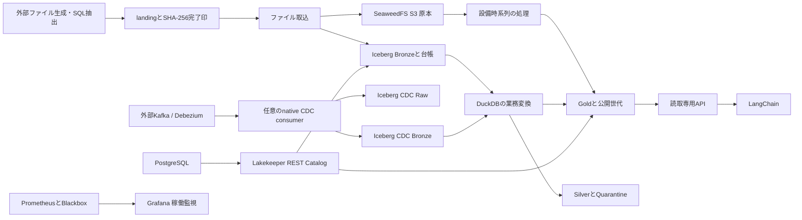
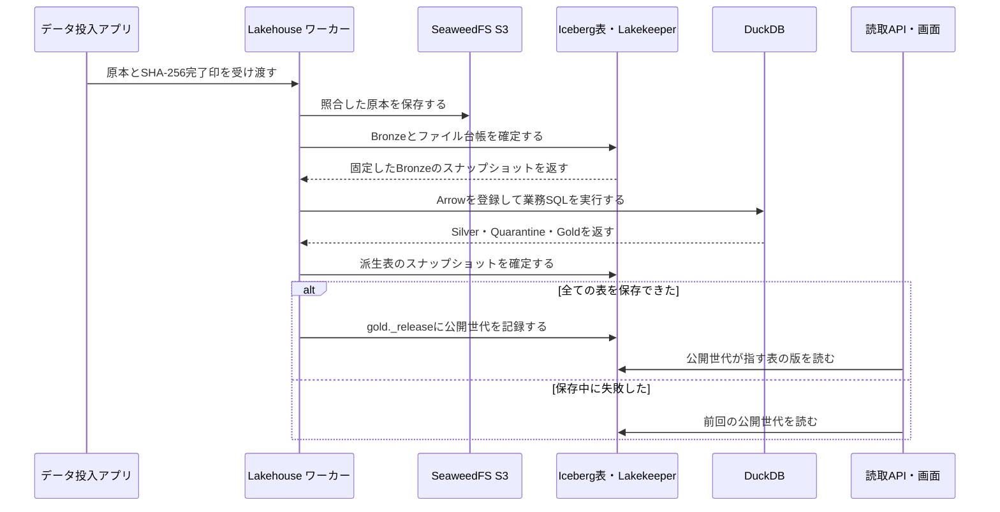

# アーキテクチャと業務契約

<!-- doc-purpose:start -->
> **役割:** 責務、元の業務契約、公開世代、既存機能の関係を確認します。
>
> **対象読者:** 初めて使う人 / 基盤構築担当
>
> **読むタイミング:** 実装を理解・変更するとき。
>
> **前提となる資料:** なし。必要な用語は本文で確認します。
>
> **次に読む資料:** [SQL Server・Kafka・データ投入アプリとの接続](<SOURCES.md>)
>
> **文書一覧:** [目的・読者から探す文書マニフェスト](<../DOCUMENTATION-MANIFEST.md>)
<!-- doc-purpose:end -->

## DuckDBとは

DuckDBは分析用のSQLエンジンです。Pythonのワーカーに組み込み、列指向のArrowデータをSQLで集計できます。Foundation Rでは1台のホスト上で、受注・出荷の結合、工場ごとの日次集計、設備の1分窓集計などを担当します。

| 役割 | 製品 | 受け持つ処理 |
| --- | --- | --- |
| 計算 | DuckDB | Arrowを入力に、業務SQLの型変換・検査・集計を実行 |
| テーブルの読み書き | PyIceberg | Icebergの行をArrowで読み、変換結果を書き込み、スナップショットを確定 |
| カタログ | LakekeeperとPostgreSQL | 名前空間・表・メタデータの位置とカタログの永続状態を管理 |
| 保存 | SeaweedFS S3 | 原本とIcebergのデータファイルを永続化 |

処理上限は下記の単一ホスト構成に合わせて設定しています。複数ホストでの分散実行や既存PySparkジョブは互換構成のSparkを使います。

## UNIXの責務分離とDDD

投入アプリは原本を作ります。入力アダプターは完了印とバイト列を照合して保管します。DuckDBはバッチごとにUTCのインメモリ接続を作り、承認されたSQLだけをArrowへ実行します。永続化の責務はLakekeeper、PostgreSQLとS3にあります。APIは固定された処理名とGoldデータセットを提供します。CLIとCIは同じAPIで確認できます。モデルは読取専用の利用者です。

| 文脈 | 言葉の意味 |
| --- | --- |
| 受け渡し | Rawは原本です。ファイルのSHA-256と相対パスで識別します。landing上でファイルを削除しても業務上のDELETEにはしません。 |
| 製造計画・実績 | 指図、実績、停止は別粒度です。Goldでは工場×UTC日へそれぞれ集計してから結合します。 |
| 受注・出荷 | 出荷を受注キーへ集約します。未出荷数、遅延出荷、充足率の意味は既存SQLに従います。 |
| 品質 | Silverの候補をキーごとに先に選び、代表エラーをQuarantineへ出します。最新候補が不正でも旧版へ戻しません。 |
| CDC | SQL Serverのストリーミング変更はsnapshot読取より後とし、commit/change LSNとserialで順序を決めます。業務DELETEは現在値を取り消し、Kafka tombstoneは別の生配送記録です。 |
| 時系列 | 設備の品質コードを残し、良品判定とは分離します。センサーの1分窓はUTC基準で、GOODだけを統計に使います。 |

`medallion/sources.json` と既存SQLを正本とし、同期元commitとSHA-256は [契約マニフェスト](../../contracts/native/foundation-source.json) に記録します。 `python3 native/check_contracts.py` で一致を確認できます。業務上の「訂正」「取消」「生産日」「品質」を変更する場合は、業務オーナーと意味を決めてからSQL・独立期待値を更新します。構想書のSail、RisingWave、GreptimeDB/InfluxDB、DataFusion、Ballista、Cometは評価候補です。標準構成はDuckDBとPyIcebergで、時系列はIcebergバッチです。ミリ秒級のオンラインTSDB性能、分散処理、候補製品間の比較結果は現時点で未計測です。

## 公開と失敗時の一貫性

Icebergは表ごとにcommitします。14本のMES/ERP SQLと、該当する設備時系列をすべて保存できた時点で、最後に `gold._release` に出力スナップショットを登録します。APIはその世代だけを参照します。途中で失敗すると直接Icebergを読む利用者には各表の最新状態が見えるため、一貫した世代が必要な場合は公開マニフェストを参照してください。read APIから古い公開世代も指定できます。参照する表スナップショットも一緒に保持する必要があります。

1つのCompose projectで各namespaceのwriterは1つです。複数レプリカや他製品からの並行書き込みは運用範囲外です。CPU、メモリ、原本サイズ、テーブル走査の行数とサイズには上限を設けています。単体100,000行・業務表64 MiBの走査上限を超えた場合は、別のdataset分割や分散構成を検証してから適用します。

### ファイル受け渡しから公開まで

## 元のFoundationとの比較

比較元は [既存Foundationのmain](https://github.com/hiromura16/lakehouse-foundation/tree/8adaef6d28a4fa01f2e409fd01a568cd6770e071) です。既存の6ソース契約と合成データの期待値を両構成で共有します。

| 観点 | 元のFoundation | Foundation R |
| --- | --- | --- |
| 標準の変換・参照 | Trinoで業務SQLを実行。Sparkクラスタを追加可能 | 組み込みのDuckDBとPyIcebergで単一ホスト実行。スナップショットを固定したAPIを提供 |
| 取り込み | ファイル、SQL Server、既存Debezium/Kafka用の配置と管理 | 同じファイル・SQLバッチ契約。外部Kafka互換ブローカー向けのネイティブCDCと設備JSONLを追加 |
| 業務・運用GUI | 操作ポータル、Superset、Kafka UI、n8n、監視などが豊富 | Grafana、Gold閲覧、Lakekeeper、Prometheusを使う軽量な入口。既存の各画面は互換構成で起動可能 |
| 監視・オーケストレーション | Prometheus、Grafana、Loki、Vector、Airflow、n8nなど | 設定ファイルで標準アプリの監視を配備。ログ基盤とオーケストレーションは互換構成 |
| 新しいデータ利用 | Gold API、MCP、LangChainのサンプル | 設備の最新値・1分集計と全表の公開世代。Gold閲覧画面とLangChainで表の版を確認可能 |
| 処理規模 | Spark分散構成・外部分析ツールを追加可能 | 標準は単一ホスト。複数ノードと既存Sparkジョブには互換構成を使用 |

標準構成の機能数は既存Foundationの全プロファイルより少なく、JVMなしで配備できる変換・閲覧の経路と設備時系列の扱いが増えています。

## 既存機能の入口

| 機能 | 起動する構成 |
| --- | --- |
| S3、Iceberg、メダリオン、SQLバッチ、設備時系列、稼働監視、Gold API、LangChain | RのルートCompose |
| KafkaイベントのRawとCurrent State | ルートComposeと `compose.cdc.yaml` |
| Trino、Spark、Superset、Jupyter、Airflow、n8n、Qdrant、Marquez、MCP、従来GUI、Samba、詳細ログ監視、Sail比較 | [Foundation互換構成](../../FOUNDATION.md) |
| SQL ServerのDebezium登録、固定CDCのRaw再構築 | [FoundationのCDC](../CDC.md)。Kafka Connect / DebeziumはJVMで稼働 |

互換構成は元と同じ入口を保ち、JVMサービスを必要に応じて別プロジェクトで起動できます。互換構成の既存手順のclone先は元のFoundationです。同じコードをRのcheckoutで動かす場合は、専用のprivate設定とプロジェクト名を使います。Rから元の本番namespace・topic・offsetへ切り替えるマイグレーションは実施していません。
