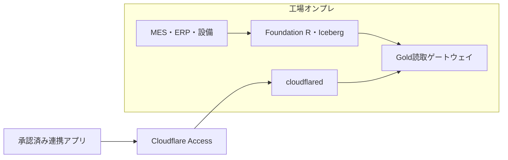

# オンプレとCloudflareをつなぐ

<!-- doc-purpose:start -->
> **役割:** Cloudflare TunnelとAccessで承認済みGoldを読み取る経路を配備します。
>
> **対象読者:** 基盤構築担当 / 運用担当
>
> **読むタイミング:** オンプレの業務集計を拠点外の承認済みアプリへ提供するとき。
>
> **前提となる資料:** [Foundation Rの初回導入と操作](<START.md>)
>
> **次に読む資料:** [会社VMの受入手順と合格条件](<ACCEPTANCE.md>)
>
> **文書一覧:** [目的・読者から探す文書マニフェスト](<../DOCUMENTATION-MANIFEST.md>)
<!-- doc-purpose:end -->

工場内の入力、SQL処理、Icebergの保存はオンプレで実行します。拠点外からの読取はCloudflare Accessを通し、承認したGoldの固定世代・列だけを返す連携サービスを使います。管理画面、工場のDB、Kafka、SMBは工場側のネットワークと権限で運用します。



## 公開するデータを選ぶ

1. 通常のオンプレ配備でGoldを生成し、承認した表、公開世代、列、最大行数を記録します。
2. [ポリシーの例](../../native/edge/policy.example.json) を配備先VMの非公開領域へコピーします。例のチーム、AUD、公開世代と列を実際の承認内容に合わせます。
3. 読取トークン、ポリシー、下記のトンネルトークンを、配備先VMの運用者だけが読めるファイルへ格納します。

Goldの応答が行数上限を超えて切り詰められた場合や、指定世代が失効した場合、ゲートウェイはデータを返しません。公開経路は `GET /gold/<許可したデータセット名>` のみで、問い合わせ文字列は受け付けません。アプリは共有キャッシュを無効にするレスポンスを返し、同時に上流を読む処理を4件までに制限します。

## Accessアプリとトンネルを設定する

1. Cloudflare Oneで連携アプリ専用のHTTPSホスト名に対応するセルフホストAccessアプリを作ります。連携アプリ用の **Service Auth** ポリシーで、承認されたサービス資格情報に限定します。連携はその資格情報を使用します。
2. **Networking → Tunnels** で専用のリモート管理トンネルを作成し、トンネルトークンを取得します。運用者だけ読めるファイルに保存します。
3. トンネルの公開アプリケーション経路で専用ホスト名をサービス `http://edge-gold:8080` に関連づけます。**Protect with Access** を有効にし、チーム名と対象AccessアプリのAUDを設定します。ゲートウェイ側にも同じ値を登録します。
4. Cloudflareに到達する経路を配備先で確認します。Composeの既定はHTTP/2で、TCP 7844の外向き接続を使います。QUICを選ぶ場合はUDP 7844も必要です。ゲートウェイは署名鍵をチームのHTTPSエンドポイントから取得します。会社でHTTPSプロキシが必要な場合は `CF_EDGE_HTTPS_PROXY` を使い、TLS検査用のCAは [会社VMのビルド手順](COMPANY.md) に従います。

[セルフホストAccessアプリ](https://developers.cloudflare.com/cloudflare-one/access-controls/applications/http-apps/self-hosted-public-app/) · [サービス資格情報](https://developers.cloudflare.com/cloudflare-one/access-controls/service-credentials/service-tokens/) · [トンネルのOrigin設定](https://developers.cloudflare.com/cloudflare-one/networks/connectors/cloudflare-tunnel/configure-tunnels/origin-parameters/) · [接続事前確認](https://developers.cloudflare.com/cloudflare-one/networks/connectors/cloudflare-tunnel/troubleshoot-tunnels/connectivity-prechecks/)

## DokployのComposeに追加する

対象サービスのEnvironmentへ以下を追加します。値は配備先で管理している実際の絶対パスに置換してください。ファイルは `LANDING_UID` のユーザーが読み取れるよう配置し、他の通常ユーザーが読み取れないことを確認します。

```dotenv
CF_TUNNEL_TOKEN_FILE=/path/to/private/tunnel-token
CF_EDGE_POLICY_FILE=/path/to/private/policy.json
CF_EDGE_READER_FILE=/path/to/private/lakehouse-reader-token
CF_TUNNEL_PROTOCOL=http2
```

[DokployのAdvanced → Command](COMPANY.md) で、対象サービス名と配備時のComposeファイルは維持し、`-f compose.cloudflare.yaml` を追加します。配備先ではトンネルと読取ゲートウェイのホストポートを開ける操作が不要です。

`CF_EDGE_READER_FILE` の内容は同じサイトの `READER_TOKEN` の値1行です。ゲートウェイはこの値で内部APIへ問い合わせます。トンネル認証のトークン、Accessのサービス資格情報、基盤の読取トークンは別々に管理してください。[トンネルのtoken-file](https://developers.cloudflare.com/cloudflare-one/networks/connectors/cloudflare-tunnel/configure-tunnels/run-parameters/)

## 受入と切り戻し

| 試験 | 合格条件 |
| --- | --- |
| 正しい認証と公開範囲 | 対象のサービス資格情報で許可表を取得し、承認世代・列・行数と一致する |
| 拒否 | 未認証、期限切れ・別AUD・改ざん・重複ヘッダー、未許可経路、書込メソッドで業務値が返らない |
| 障害 | トンネル停止時もオンプレの取込とGold生成が継続し、復旧後に承認した世代を読める |
| 切り戻し | 先にトンネル経路を無効にし、外から読めないことを確認する。対象サービスからだけ設定を外して再配備し、専用資格情報を無効化する |

リポジトリでは合成RSA署名でゲートウェイの拒否・許可と列制御を検査します。実テナントのルーティング・IdP・企業CAとWAN断を含む試験は設置先で行います。

## 承認した成果物を非公開R2へ持ち出す

閲覧トンネルと成果物の送信は別の経路です。転送したい場合は、R2で公開アクセスを無効にした専用バケットを作り、そのバケットのObject Read & Writeに権限を絞った資格情報を発行します。転送CLIはR2を使わない場合のオンプレ配備に含める必要がありません。

承認済みのCSV、JSON、Parquetと、その分類・公開世代・SHA-256を記したmanifestを同じ非公開フォルダに置きます。1ファイル16 MiB、全体64 MiB以下です。行数が途中で切られた応答や未承認の原本・隔離データを、成果物として承認しないでください。

```json
{
  "format_version": 1,
  "classification": "approved_external",
  "dataset": "factory_daily_production",
  "release": "123",
  "files": [
    {
      "name": "production.csv",
      "size_bytes": 26,
      "sha256": "承認時に計算した64桁のSHA-256"
    }
  ]
}
```

Python 3.14とuvを使い、まずネットワーク転送なしでファイルを照合します。

**Bash / Zsh共通**

```bash
uv venv --python 3.14 .venv-r2
uv pip sync --python .venv-r2/bin/python \
  --require-hashes native/edge/requirements-r2.lock
.venv-r2/bin/python -m native.edge.r2 /path/to/private/approved.json
```

承認した担当者がGit外の環境で `R2_ACCESS_KEY_ID` と `R2_SECRET_ACCESS_KEY` を設定します。短期資格情報の場合は `R2_SESSION_TOKEN` も設定します。承認先のアカウントIDとバケット名を明示して実行します。

**Bash / Zsh共通**

```bash
.venv-r2/bin/python -m native.edge.r2 /path/to/private/approved.json \
  --publish --account "$r2_account_id" --bucket "$r2_bucket"
```

成果物はハッシュで分けたキーに作成し、最後にmanifestを確定します。通信が切れた場合はローカルの承認済みファイルを維持し、同じmanifestで再試行します。既存オブジェクトを読み、内容が異なる場合は停止します。CIでは条件付き書き込みを模擬して順序と再送を検査します。配備先では対象バケットへの権限、ネットワーク断からの回復、他アカウントからのアクセス拒否を合成ファイルで確認してください。[R2認証](https://developers.cloudflare.com/r2/api/tokens/) · [条件付き書き込み](https://developers.cloudflare.com/r2/api/s3/conditional-operations/) · [データ所在地](https://developers.cloudflare.com/r2/reference/data-location/)
