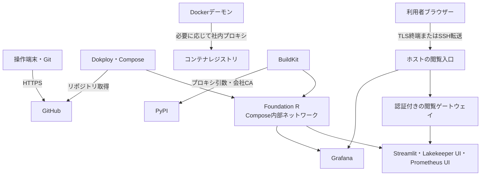

# Dokployと企業ネットワーク

<!-- doc-purpose:start -->
> **役割:** Git・Docker・BuildKitの通信を準備し、Dokployで配備します。
>
> **対象読者:** 初めて使う人 / 基盤構築担当
>
> **読むタイミング:** 会社環境の準備と配置時。
>
> **前提となる資料:** なし。必要な用語は本文で確認します。
>
> **次に読む資料:** [運用、バックアップ、受入試験](<OPERATIONS.md>)
>
> **文書一覧:** [目的・読者から探す文書マニフェスト](<../DOCUMENTATION-MANIFEST.md>)
<!-- doc-purpose:end -->

## 通信と配置の全体図



会社向けの疎通はGit取得、イメージ取得、依存取得、利用者のブラウザー経路で分けて確認します。

## プロキシの設定箇所を確認する

| どこで通信するか | 準備するもの | 確認方法 |
| --- | --- | --- |
| cloneする端末のGit | OSの信頼CA、組織指定の `HTTPS_PROXY` またはGit設定 | `git ls-remote` |
| DokployのGit取得プロセス | Dokployの実行環境でGitHubに到達する経路とCA。GitHub Appを選ぶ場合は対象へのアクセス許可 | 初回Deployログのcheckout |
| Docker Engineのイメージ取得 | デーモンのプロキシとCA、レジストリへのアクセス | `docker compose pull --ignore-buildable` と `docker compose build` |
| BuildKit内のPython依存取得 | Composeの標準proxy引数と `CORPORATE_CA_FILE` / `CORPORATE_CA_SHA256` | `docker compose build lakehouse` |
| 稼働中のサービス | Composeの内部DNS。Kafkaを使う場合は直接到達するTCPとTLS | `ps`、監視、受入試験 |

公式の [Docker Engineのプロキシ](https://docs.docker.com/engine/daemon/proxy/) と [DockerとOSの信頼CA](https://docs.docker.com/engine/network/ca-certs/) に従って、管理者がサーバー側を設定します。ホストでDockerの再起動が必要な変更は既存サービスの保守時間に適用します。独立したBuildKitを使う場合は、そのビルダー自身のレジストリ到達性と信頼CAも確認します。DokployのEnvironmentでの設定は、ホストのDockerデーモンの設定とは別です。

BuildKit用の設定はprivate `site.env` またはDokployの対象ComposeのEnvironmentへ入力します。

```dotenv
HTTP_PROXY=http://proxy.example.invalid:3128
HTTPS_PROXY=http://proxy.example.invalid:3128
NO_PROXY=corp.example.invalid
CORPORATE_CA_FILE=/absolute/path/to/company-public-chain.pem
CORPORATE_CA_SHA256=PEM全体の64桁のSHA-256
```

値は会社指定のものへ置き換えます。CAファイルには公開証明書チェーンをPEM形式で置きます。ビルドは既存の公開ルートを保持したうえで社内ルートを追加します。CAの内容を変更したら対応する `CORPORATE_CA_SHA256` も更新し、再ビルドと再配置を実行します。ハッシュが変わると対象イメージの信頼設定と後続の依存取得をやり直します。ハッシュを設定していない既存環境では、`docker compose build --no-cache` で対象のPythonサービスを再ビルドしてから再配置してください。内部service名は `NO_PROXY` に自動追加します。Composeのビルド引数として渡した資格情報は標準の実行コンテナには入りません。Docker CLI全体に `proxies` を設定すると実行コンテナにも注入されるため、認証付きプロキシは対象サービスのビルド設定で管理します。

会社CAを使う場合は `sha256sum` の出力の先頭列を `CORPORATE_CA_SHA256` に設定します。`CORPORATE_CA_FILE` と同じPEMファイルを指定してください。[BuildKitのキャッシュとsecret](https://docs.docker.com/build/cache/invalidation/#build-secrets)

**Bash / Zsh共通**

```bash
sha256sum /absolute/path/to/company-public-chain.pem
```

会社VMでの最初の疎通確認です。GitのTLS検証は有効にし、証明書エラーの場合は会社指定のCAを管理者に確認します。成功すると `refs/heads/main` とコミットIDが表示されます。

**Bash / Zsh共通**

```bash
git ls-remote --exit-code https://github.com/hiromura16/lakehouse-foundation-R.git refs/heads/main
```

Dockerが取得する固定イメージの起点は Docker Hub、Quay、GHCR です。Python依存は通常 PyPI と files.pythonhosted.org から取得します。会社ミラーへ切り替える場合は、ミラーのCAと同じ配布物のハッシュを確認してください。CIや管理者が `config --quiet` を使うのは、展開済みの設定には秘密値が含まれるためです。導入先で実測する項目は [受入手順](ACCEPTANCE.md) にあります。

### 社内のPythonパッケージミラーを使う

会社で公開PyPIの代わりに社内ミラーを使う場合は、接続先を記入した
`uv.toml` を配備先VMの非公開ディレクトリに置きます。BuildKitは
`requirements.lock` の版とSHA-256が一致するwheelだけを使います。
ミラーには対象CPU・Python版のwheelを用意します。

```toml
[[index]]
name = "company"
url = "https://packages.example.invalid/simple"
default = true
authenticate = "always"
```

private `site.env` またはDokployの対象ComposeのEnvironmentに
`CORPORATE_UV_CONFIG_FILE` を絶対パスで記載します。ミラーにログインが
必要な場合は `CORPORATE_PYPI_NETRC_FILE` も指定します。
認証が不要なミラーでは `authenticate = "always"` の行を外します。会社のCAを
使うミラーには `CORPORATE_CA_FILE` を指定します。設定ファイルは
Docker CLIが動く側から読める場所とし、ミラーの認証ファイルは所有者のみ
読取可能にします。URLには資格情報を埋め込まず、`.netrc` の対象ホストを
管理者が指定します。

```dotenv
CORPORATE_UV_CONFIG_FILE=/path/to/private/uv.toml
CORPORATE_PYPI_NETRC_FILE=/path/to/private/pypi.netrc
```

ミラーの設定と認証はBuildKitの依存取得ステップにマウントされます。
Dockerイメージの実行設定には渡しません。ミラーのファイルやCAだけを
更新して疎通を確認する場合は、Dockerのビルドキャッシュを使わずに
再ビルドします。確認は会社側で公開してよい情報に絞り、認証ファイルは
Gitやログに残さないでください。

Compose 5系と新しいBuildxの組み合わせでは、Gitの作業ディレクトリ
外に置いた会社CAやミラーファイルのビルドで、`additional privileges
requested: ... fs.read=...` が出る場合があります。ビルドを担当する
管理者は、`docker compose build --print` で対象サービスの計画を生成し、
`docker buildx bake --load --allow fs.read=対象ファイル` へ渡します。
許可引数は外部の入力ファイルごとに指定します。配備時は構築済みの
同じプロジェクト名を選び、`up --no-build --pull missing` で使います。
Dokployがこの組み合わせを使う場合は、配備先で事前ビルドを行い、
同じApp Name・Composeファイル・Environmentで **Run Command** に
`--no-build --pull missing` を指定します。
[Composeのビルド計画](https://docs.docker.com/reference/cli/docker/compose/build/)
· [Bakeのファイル読取許可](https://docs.docker.com/reference/cli/docker/buildx/bake/#allow)

会社CAだけを追加する場合の例です。ミラーを使う場合は、秘密ファイルの
内容を表示せず、承認されたパスをそれぞれ独立した `--allow` へ追加します。

**Bash / Zsh共通**

```bash
docker compose --env-file "$site" -p "$project" build --print lakehouse |
  docker buildx bake --file - --load \
    --allow "fs.read=/absolute/path/to/company-public-chain.pem"
```

[uvのpip設定](https://docs.astral.sh/uv/reference/settings/#pip) · [uvの認証形式](https://docs.astral.sh/uv/concepts/authentication/http/#netrc-files) · [Dockerのビルド用secret](https://docs.docker.com/build/building/secrets/)

合成ミラーを用いた受入では、BakuのBuildKitで同じ依存取得処理を実行
しました。正しいCAと認証で導入でき、CAなし・誤CA、認証なし・誤認証、
ロックのSHA-256と違うwheelは拒否されました。合成HTTP CONNECTでは
プロキシ経由でインデックスとwheelに到達しました。ビルド後の仮想環境と
次のRUNに認証値が残らないことを確認しました。会社のサーバーでは同じ
接続の検査を会社のCA・認証・許可リストで行います。

## Dokployの設定を確認する

[Dokployでの初回配備](START.md) の手順でサービスを作成します。公開GitHubのProviderは **Git** を選択します。GitHub Appによる取得を組織で管理している場合は、対象リポジトリへのアクセスを許可したアプリを使い、Providerを **GitHub** にします。

Dokployの **Environment → Create Environment File** は指定したComposeと同じ階層に `.env` を生成します。このプロジェクトではComposeが必要な項目を変数展開します。非公開の `site.env`、受け渡しディレクトリ、企業CAは配備先VMの利用者が管理し、DokployがGitを展開し直すディレクトリの外に置きます。正しいファイルがマウントされていることは **Docker → Containers → View Mounts** で確認できます。BuildKitのCAはComposeを実行する側からも読める場所に置きます。Dokployがコンテナで動く同一VMでは、管理者がDokployコンテナへマウントしている管理領域のcheckout外へ配置します。共有VMでは、Dokployが生成した `.env` を一般ユーザーから読めないよう、生成先の親ディレクトリの権限を管理者が確認します。

ブラウザーはVM上のポート18501のGrafanaへ接続します。別端末からは社内で許可されたSSH転送またはHTTPS経路を利用します。DokployのDomainsでGrafanaをHTTPS化する場合は、service port 3000を指定し、`GRAFANA_ROOT_URL` を実際のHTTPS URL、`GRAFANA_COOKIE_SECURE=true` にします。

### 初回Deployの前に配備先VMを診断する

配備先VMへSSHで入り、同じコミットを展開したリポジトリのルートで実行
します。`site` に非公開環境ファイルのパス、`project` にDokployの
画面に表示される **App Name** を設定します。配置に使う追加Compose
ファイルやプロファイルがある場合は、Deployと同じ順番で指定します。

**Bash / Zsh共通**

```bash
site="$HOME/.config/lakehouse-foundation-r/site.env"
project="APP_NAME_FROM_HEADER"
python3 scripts/preflight.py --env-file "$site" -p "$project" -f compose.yaml
```

Dockerを通常 `sudo` で利用しているVMでは `--sudo` を付けます。
このオプションは `sudo -n docker` を使うため、事前に管理者の承認と
sudoの利用権限が必要です。`--env-file`、`-f`、`--profile` は複数
指定できます。複数の環境ファイルは、配備時と同じ優先順で後の値が
上書きします。環境変数の優先順位もDeploy時と揃えます。
[Composeの変数展開](https://docs.docker.com/compose/how-tos/environment-variables/variable-interpolation/)

| 診断 | 結果の見方 |
| --- | --- |
| `COMPOSE` | `FAIL` はファイルの順序、必須変数、プロファイルなどの設定を確認します。展開済みの秘密値をログへ出す必要はありません。 |
| `ENGINE` | `FAIL` はDockerへの接続先と読取権限を確認します。 |
| `HOST_FILES` | `missing` は既存ファイル・ディレクトリが必須の参照元、`invalid` は通常ファイルが必要なsecret・configの種別違いです。`review` では権限やDockerの自動作成設定を確認します。 |
| `HOST_ROUTES` / `IPAM` | `docker_overlap` は割当済み・宣言済みの標準IPAMとの重複です。`route_overlap`、外部ネットワーク、独自ドライバー、再作成の警告は、会社の経路・命名規則を管理者と確認します。 |
| `IPV4_POOL` | 自動割当が必要な標準bridgeの数と、既存割当・直接接続経路から見た空きの概算を返します。足りない場合は既存アプリのネットワークを削除せず、管理者と割当計画を確認します。 |

`FAIL` は終了1、使い方のエラーは終了2です。`WARN` や `SKIP` だけの
場合は終了0ですが、該当項目はDeploy前に個別に確認します。`--json` は
同じ診断コードと件数を返します。ファイルの中身、展開済みCompose設定、
パス、CIDR、コマンドのエラー詳細は出力しません。ネットワーク・
ボリュームの作成や削除、イメージ取得、サービスの起動は行いません。

SSHやTCPのDocker context、Docker Desktop、他コンテナ内では、Dockerの
接続と既存ネットワークを確認できます。実際にbindを扱う配備VMの
ファイル・経路は別環境になるため `SKIP` です。その場合は配備先
VM自身で再実行します。IPv4プールの概算には、検出できた直接接続経路と
割当済みDockerネットワークを使います。VPNなどの追加経路は明示した
IPAMの範囲と照合します。名前解決、同時に起きる割当、IPv6の自動枯渇、
実行ユーザーやBuildKitの読取可否は別途確認します。
[Compose config](https://docs.docker.com/reference/cli/docker/compose/config/)
· [Dockerの自動サブネット割当](https://docs.docker.com/engine/network/#automatic-subnet-allocation)

## 追加のCompose構成を有効にする

Dokployの標準Deployには `--build` が含まれます。待機や追加構成を指定する場合は、UIに表示される対象サービスのApp Nameを使い、**Advanced → Run Command** の **Command** 欄に入力します。Dokployが先頭の `docker` を付けるので、`compose` で始めます。監視設定と閲覧入口の公開ファイルは、読み取り権限を固定してイメージへ組み込みます。Gitで設定を変更したら `--build` 付きで再配備します。DockerとBuildKitのレジストリ到達性を確認します。カスタムのCommandでは、DokployのPull Imagesに対応する `--pull always` と、DokployのMountsを使う場合の `--project-directory` が自動で追加されないため、必要な場合は既定コマンドを参考に併せて指定します。 [Dokploy v0.31のコマンド組立](https://github.com/Dokploy/dokploy/blob/v0.31.0/packages/server/src/utils/builders/compose.ts#L125-L188)

```text
compose -p APP_NAME_FROM_HEADER --env-file .env -f compose.yaml up -d --build --wait --wait-timeout 180 --remove-orphans
```

[任意の閲覧画面](GUI.md) を有効にする場合は、非公開の認証ファイルを準備して、Command欄に `-f compose.gui.yaml` を追加します。

[運用ツール](TOOLS.md) を有効にする場合は、ホストで追加ツールの秘密ファイルを作成して、`tools.env` の値を同じComposeのEnvironmentにも登録します。秘密ファイルのパスはDockerを実行するホストから参照できる絶対パスを使います。Command欄に `-f compose.tools.yaml` を加え、n8nをHTTPSで使う場合は公開originとSecure Cookieを設定します。n8nは既定でGHCRから取得し、`N8N_IMAGE_REPO=docker.io/n8nio/n8n` または `docker.n8n.io/n8nio/n8n` に切り替えられます。3レジストリで同一digestを確認しています。OpenObserveの公開レジストリを変更する場合は `OPENOBSERVE_IMAGE_PATH=public.ecr.aws/zinclabs/openobserve` を指定できます。固定するdigestは両方で同一です。

Dokployの再取得後も、名前付きデータvolumeおよびcheckout外のlanding・設定・CAを維持します。同じホストに検証用と本番用を配置する場合は、個別のappName、ポート、landingを割り当てます。標準ポートはAPI 18502、Grafana 18501です。社内の実プロキシ、IdP、証明書とDokployのGUI操作は、導入先で [受入手順](OPERATIONS.md) を実行して確認します。

[Dokploy Docker Compose](https://docs.dokploy.com/docs/core/docker-compose) · [公開リポジトリのHTTPS取得](https://docs.dokploy.com/docs/core/providers) · [GitHub App連携](https://docs.dokploy.com/docs/core/github) · [ComposeのDomains](https://docs.dokploy.com/docs/core/docker-compose/domains)
