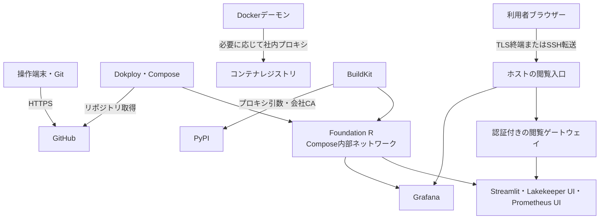

# Dokployと企業ネットワーク

<!-- doc-purpose:start -->
> **役割:** Git・Docker・BuildKitの通信を準備し、Dokployで配備します。
>
> **対象読者:** 初めて使う人 / 基盤構築担当
>
> **読むタイミング:** 会社環境の準備と配置時。
>
> **前提となる資料:** なし。必要な用語は本文で確認します。
>
> **次に読む資料:** [運用、バックアップ、受入試験](<OPERATIONS.md>)
>
> **文書一覧:** [目的・読者から探す文書マニフェスト](<../DOCUMENTATION-MANIFEST.md>)
<!-- doc-purpose:end -->

## 通信と配置の全体図



会社向けの疎通はGit取得、イメージ取得、依存取得、利用者のブラウザー経路で分けて確認します。

## プロキシの設定箇所を確認する

| どこで通信するか | 準備するもの | 確認方法 |
| --- | --- | --- |
| cloneする端末のGit | OSの信頼CA、組織指定の `HTTPS_PROXY` またはGit設定 | `git ls-remote` |
| DokployのGit取得プロセス | Dokployの実行環境でGitHubに到達する経路とCA。GitHub Appを選ぶ場合は対象へのアクセス許可 | 初回Deployログのcheckout |
| Docker Engineのイメージ取得 | デーモンのプロキシとCA、レジストリへのアクセス | `docker compose pull --ignore-buildable` と `docker compose build` |
| BuildKit内のPython依存取得 | Composeの標準proxy引数と `CORPORATE_CA_FILE` | `docker compose build lakehouse` |
| 稼働中のサービス | Composeの内部DNS。Kafkaを使う場合は直接到達するTCPとTLS | `ps`、監視、受入試験 |

公式の [Docker Engineのプロキシ](https://docs.docker.com/engine/daemon/proxy/) と [DockerとOSの信頼CA](https://docs.docker.com/engine/network/ca-certs/) に従って、管理者がサーバー側を設定します。ホストでDockerの再起動が必要な変更は既存サービスの保守時間に適用します。独立したBuildKitを使う場合は、そのビルダー自身のレジストリ到達性と信頼CAも確認します。DokployのEnvironmentでの設定は、ホストのDockerデーモンの設定とは別です。

BuildKit用の設定はprivate `site.env` またはDokployの対象ComposeのEnvironmentへ入力します。

```dotenv
HTTP_PROXY=http://proxy.example.invalid:3128
HTTPS_PROXY=http://proxy.example.invalid:3128
NO_PROXY=corp.example.invalid
CORPORATE_CA_FILE=/absolute/path/to/company-public-chain.pem
```

値は会社指定のものへ置き換えます。CAファイルには公開証明書チェーンをPEM形式で置きます。ビルドは既存の公開ルートを保持したうえで社内ルートを追加します。CAの内容を変更したら `docker compose build --no-cache lakehouse` で依存層を再作成し、再配置します。内部service名は `NO_PROXY` に自動追加します。Composeのビルド引数として渡した資格情報は標準の実行コンテナには入りません。Docker CLI全体に `proxies` を設定すると実行コンテナにも注入されるため、認証付きプロキシは対象サービスのビルド設定で管理します。

会社VMでの最初の疎通確認です。GitのTLS検証は有効にし、証明書エラーの場合は会社指定のCAを管理者に確認します。成功すると `refs/heads/main` とコミットIDが表示されます。

**Bash / Zsh共通**

```bash
git ls-remote --exit-code https://github.com/hiromura16/lakehouse-foundation-R.git refs/heads/main
```

Dockerが取得する固定イメージの起点は Docker Hub、Quay、GHCR です。Python依存は通常 PyPI と files.pythonhosted.org から取得します。会社ミラーへ切り替える場合は、ミラーのCAと同じ配布物のハッシュを確認してください。CIや管理者が `config --quiet` を使うのは、展開済みの設定には秘密値が含まれるためです。導入先で実測する項目は [受入手順](ACCEPTANCE.md) にあります。

### 社内のPythonパッケージミラーを使う

会社で公開PyPIの代わりに社内ミラーを使う場合は、接続先を記入した
`uv.toml` を配備先VMの非公開ディレクトリに置きます。BuildKitは
`requirements.lock` の版とSHA-256が一致するwheelだけを使います。
ミラーには対象CPU・Python版のwheelを用意します。

```toml
[[index]]
name = "company"
url = "https://packages.example.invalid/simple"
default = true
authenticate = "always"
```

private `site.env` またはDokployの対象ComposeのEnvironmentに
`CORPORATE_UV_CONFIG_FILE` を絶対パスで記載します。ミラーにログインが
必要な場合は `CORPORATE_PYPI_NETRC_FILE` も指定します。
認証が不要なミラーでは `authenticate = "always"` の行を外します。会社のCAを
使うミラーには `CORPORATE_CA_FILE` を指定します。設定ファイルは
Docker CLIが動く側から読める場所とし、ミラーの認証ファイルは所有者のみ
読取可能にします。URLには資格情報を埋め込まず、`.netrc` の対象ホストを
管理者が指定します。

```dotenv
CORPORATE_UV_CONFIG_FILE=/path/to/private/uv.toml
CORPORATE_PYPI_NETRC_FILE=/path/to/private/pypi.netrc
```

ミラーの設定と認証はBuildKitの依存取得ステップにマウントされます。
Dockerイメージの実行設定には渡しません。ミラーのファイルやCAだけを
更新して疎通を確認する場合は、Dockerのビルドキャッシュを使わずに
再ビルドします。確認は会社側で公開してよい情報に絞り、認証ファイルは
Gitやログに残さないでください。
[uvのpip設定](https://docs.astral.sh/uv/reference/settings/#pip) · [uvの認証形式](https://docs.astral.sh/uv/concepts/authentication/http/#netrc-files) · [Dockerのビルド用secret](https://docs.docker.com/build/building/secrets/)

合成ミラーを用いた受入では、BakuのBuildKitで同じ依存取得処理を実行
しました。正しいCAと認証で導入でき、CAなし・誤CA、認証なし・誤認証、
ロックのSHA-256と違うwheelは拒否されました。合成HTTP CONNECTでは
プロキシ経由でインデックスとwheelに到達しました。ビルド後の仮想環境と
次のRUNに認証値が残らないことを確認しました。会社のサーバーでは同じ
接続の検査を会社のCA・認証・許可リストで行います。

## Dokployの設定を確認する

[Dokployでの初回配備](START.md) の手順でサービスを作成します。公開GitHubのProviderは **Git** を選択します。GitHub Appによる取得を組織で管理している場合は、対象リポジトリへのアクセスを許可したアプリを使い、Providerを **GitHub** にします。

DokployのEnvironmentはComposeの横に `.env` を生成します。このプロジェクトではComposeが必要な項目を変数展開します。非公開の `site.env`、受け渡しディレクトリ、企業CAは配備先VMの利用者が管理し、DokployがGitを展開し直すディレクトリの外に置きます。正しいファイルがマウントされていることは **Docker → Containers → View Mounts** で確認できます。BuildKitのCAはComposeを実行する側からも読める場所に置きます。Dokployがコンテナで動く同一VMでは、管理者がDokployコンテナへマウントしている管理領域のcheckout外へ配置します。共有VMでは、Dokployが生成した `.env` を一般ユーザーから読めないよう、生成先の親ディレクトリの権限を管理者が確認します。

ブラウザーはVM上のポート18501のGrafanaへ接続します。別端末からは社内で許可されたSSH転送またはHTTPS経路を利用します。DokployのDomainsでGrafanaをHTTPS化する場合は、service port 3000を指定し、`GRAFANA_ROOT_URL` を実際のHTTPS URL、`GRAFANA_COOKIE_SECURE=true` にします。

## 追加のCompose構成を有効にする

Dokployの既定コマンドに待機・再生成を追加する場合は、UIに表示される実際のappNameを使ってAdvancedのCommand欄に以下を入力します。コマンド欄には `compose` から入力します。監視設定と閲覧入口の公開ファイルは、読み取り権限を固定してイメージへ組み込みます。Gitで設定を変更したら `--build` 付きで再配備します。Dockerのレジストリ取得とBuildKitのレジストリ取得を許可してください。

```text
compose -p APP_NAME_FROM_HEADER --env-file .env -f compose.yaml up -d --build --wait --wait-timeout 180 --remove-orphans
```

[任意の閲覧画面](GUI.md) を有効にする場合は、非公開の認証ファイルを準備して、Command欄に `-f compose.gui.yaml` を追加します。

[運用ツール](TOOLS.md) を有効にする場合は、ホストで追加ツールの秘密ファイルを作成して、`tools.env` の値を同じComposeのEnvironmentにも登録します。秘密ファイルのパスはDockerを実行するホストから参照できる絶対パスを使います。Command欄に `-f compose.tools.yaml` を加え、n8nをHTTPSで使う場合は公開originとSecure Cookieを設定します。取得先には `docker.n8n.io` とDocker Hubが加わります。OpenObserveの公開レジストリを変更する場合は `OPENOBSERVE_IMAGE_PATH=public.ecr.aws/zinclabs/openobserve` を指定できます。固定するdigestは両方で同一です。

Dokployの再取得後も、名前付きデータvolumeおよびcheckout外のlanding・設定・CAを維持します。同じホストに検証用と本番用を配置する場合は、個別のappName、ポート、landingを割り当てます。標準ポートはAPI 18502、Grafana 18501です。社内の実プロキシ、IdP、証明書とDokployのGUI操作は、導入先で [受入手順](OPERATIONS.md) を実行して確認します。

[Dokploy Docker Compose](https://docs.dokploy.com/docs/core/docker-compose) · [公開リポジトリのHTTPS取得](https://docs.dokploy.com/docs/core/providers) · [GitHub App連携](https://docs.dokploy.com/docs/core/github) · [ComposeのDomains](https://docs.dokploy.com/docs/core/docker-compose/domains)
