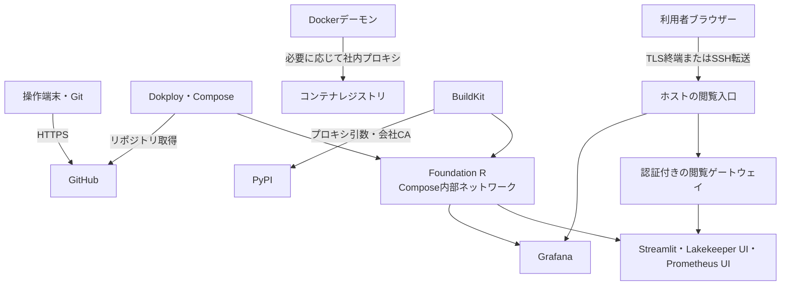

# Dokployと企業ネットワーク

<!-- doc-purpose:start -->
> **役割:** Git・Docker・BuildKitの通信を準備し、Dokployで配備します。
>
> **対象読者:** 初めて使う人 / 基盤構築担当
>
> **読むタイミング:** 会社環境の準備と配置時。
>
> **前提となる資料:** なし。必要な用語は本文で確認します。
>
> **次に読む資料:** [運用、バックアップ、受入試験](<OPERATIONS.md>)
>
> **文書一覧:** [目的・読者から探す文書マニフェスト](<../DOCUMENTATION-MANIFEST.md>)
<!-- doc-purpose:end -->

## 通信と配置の全体図



会社向けの疎通はGit取得、イメージ取得、依存取得、利用者のブラウザー経路で分けて確認します。

## プロキシの設定箇所を確認する

| どこで通信するか | 準備するもの | 確認方法 |
| --- | --- | --- |
| cloneする端末のGit | OSの信頼CA、組織指定の `HTTPS_PROXY` またはGit設定 | `git ls-remote` |
| DokployのGit取得プロセス | Dokployの実行環境でGitHubに到達する経路とCA。GitHub Appを選ぶ場合は対象へのアクセス許可 | 初回Deployログのcheckout |
| Docker Engineのイメージ取得 | デーモンのプロキシとCA、レジストリへのアクセス | `docker compose pull --ignore-buildable` と `docker compose build` |
| BuildKit内のPython依存取得 | Composeの標準proxy引数と `CORPORATE_CA_FILE` / `CORPORATE_CA_SHA256` | `docker compose build lakehouse` |
| 稼働中のサービス | Composeの内部DNS。Kafkaを使う場合は直接到達するTCPとTLS | `ps`、監視、受入試験 |

管理者がサーバー側のプロキシと信頼CAを設定します。GitのHTTPS取得で個別の信頼CAを使う場合は、取得を実行する環境から参照できる `http.sslCAInfo`（または `GIT_SSL_CAINFO`）を使います。DokployのGit取得プロセスにも、その環境の信頼設定を適用します。[GitのHTTPS設定](https://git-scm.com/docs/git-config#Documentation/git-config.txt-httpsslCAInfo) · [Docker Engineのプロキシ](https://docs.docker.com/engine/daemon/proxy/) · [DockerとOSの信頼CA](https://docs.docker.com/engine/network/ca-certs/)

ホストでDockerの再起動が必要な変更は既存サービスの保守時間に適用します。独立したBuildKitを使う場合は、そのビルダー自身のレジストリ到達性と信頼CAも確認します。DokployのEnvironmentでの設定は、ホストのDockerデーモンの設定とは別です。

BuildKit用の設定はprivate `site.env` またはDokployの対象ComposeのEnvironmentへ入力します。

```dotenv
HTTP_PROXY=http://proxy.example.invalid:3128
HTTPS_PROXY=http://proxy.example.invalid:3128
NO_PROXY=corp.example.invalid
CORPORATE_CA_FILE=/absolute/path/to/company-public-chain.pem
CORPORATE_CA_SHA256=PEM全体の64桁のSHA-256
```

値は会社指定のものへ置き換えます。CAファイルには公開証明書チェーンをPEM形式で置きます。ビルドは既存の公開ルートを保持したうえで社内ルートを追加します。CAの内容を変更したら対応する `CORPORATE_CA_SHA256` も更新し、再ビルドと再配置を実行します。ハッシュが変わると対象イメージの信頼設定と後続の依存取得をやり直します。ハッシュを設定していない既存環境では、`docker compose build --no-cache` で対象のPythonサービスを再ビルドしてから再配置してください。内部service名は `NO_PROXY` に自動追加します。Composeのビルド引数として渡した資格情報は標準の実行コンテナには入りません。Docker CLI全体に `proxies` を設定すると実行コンテナにも注入されるため、認証付きプロキシは対象サービスのビルド設定で管理します。

会社CAを使う場合は `sha256sum` の出力の先頭列を `CORPORATE_CA_SHA256` に設定します。`CORPORATE_CA_FILE` と同じPEMファイルを指定してください。[BuildKitのキャッシュとsecret](https://docs.docker.com/build/cache/invalidation/#build-secrets)

**Bash / Zsh共通**

```bash
sha256sum /absolute/path/to/company-public-chain.pem
```

会社VMでの最初の疎通確認です。GitのTLS検証は有効にし、証明書エラーの場合は会社指定のCAを管理者に確認します。成功すると `refs/heads/main` とコミットIDが表示されます。

**Bash / Zsh共通**

```bash
git ls-remote --exit-code https://github.com/hiromura16/lakehouse-foundation-R.git refs/heads/main
```

Dockerが取得する固定イメージの起点は Docker Hub、Quay、GHCR です。Python依存は通常 PyPI と files.pythonhosted.org から取得します。会社ミラーへ切り替える場合は、ミラーのCAと同じ配布物のハッシュを確認してください。CIや管理者が `config --quiet` を使うのは、展開済みの設定には秘密値が含まれるためです。導入先で実測する項目は [受入手順](ACCEPTANCE.md) にあります。

### 社内のPythonパッケージミラーを使う

会社で公開PyPIの代わりに社内ミラーを使う場合は、接続先を記入した
`uv.toml` を配備先VMの非公開ディレクトリに置きます。BuildKitは
`requirements.lock` の版とSHA-256が一致するwheelだけを使います。
ミラーには対象CPU・Python版のwheelを用意します。

```toml
[[index]]
name = "company"
url = "https://packages.example.invalid/simple"
default = true
authenticate = "always"
```

private `site.env` またはDokployの対象ComposeのEnvironmentに
`CORPORATE_UV_CONFIG_FILE` を絶対パスで記載します。ミラーにログインが
必要な場合は `CORPORATE_PYPI_NETRC_FILE` も指定します。
認証が不要なミラーでは `authenticate = "always"` の行を外します。会社のCAを
使うミラーには `CORPORATE_CA_FILE` を指定します。設定ファイルは
Docker CLIが動く側から読める場所とし、ミラーの認証ファイルは所有者のみ
読取可能にします。URLには資格情報を埋め込まず、`.netrc` の対象ホストを
管理者が指定します。

```dotenv
CORPORATE_UV_CONFIG_FILE=/path/to/private/uv.toml
CORPORATE_PYPI_NETRC_FILE=/path/to/private/pypi.netrc
```

ミラーの設定と認証はBuildKitの依存取得ステップにマウントされます。
Dockerイメージの実行設定には渡しません。ミラーのファイルやCAだけを
更新して疎通を確認する場合は、Dockerのビルドキャッシュを使わずに
再ビルドします。確認は会社側で公開してよい情報に絞り、認証ファイルは
Gitやログに残さないでください。

Compose 5系と新しいBuildxの組み合わせでは、Gitの作業ディレクトリ
外に置いた会社CAやミラーファイルのビルドで、`additional privileges
requested: ... fs.read=...` が出る場合があります。ビルドを担当する
管理者は、配備のApp Name・Composeファイル・環境ファイル・プロファイルを
揃えて `docker compose build --print` で全ビルド対象の計画を生成し、
`docker buildx bake --load --allow fs.read=対象ファイル` へ渡します。
標準構成でも `lakehouse` に加えて監視や内部ゲートウェイのイメージを
ビルドします。コマンド末尾で個別サービスを絞らず、外部ファイルごとに
読取許可を指定します。計画には展開された設定が含まれるため、ログや
共有場所に保存せず、パイプで受け渡します。

ビルドしたイメージを配備先のDocker Engineに読み込みます。Dokployでは
同じApp Name・Composeファイル・Environmentを使い、下の **Run Command**
例の `--build` を `--no-build --pull missing` に置き換えます。
ソースやビルド設定を変更したら、同じ手順で事前ビルドをやり直します。
[Composeのビルド計画](https://docs.docker.com/reference/cli/docker/compose/build/)
· [Bakeのファイル読取許可](https://docs.docker.com/reference/cli/docker/buildx/bake/#allow)

会社CAだけを追加する場合の例です。ミラーを使う場合は、秘密ファイルの
内容を表示せず、承認されたパスをそれぞれ独立した `--allow` へ追加します。

**Bash / Zsh共通**

```bash
docker compose --env-file "$site" -p "$project" -f compose.yaml build --print |
  docker buildx bake --file - --load \
    --allow "fs.read=/absolute/path/to/company-public-chain.pem"
```

[uvのパッケージインデックス設定](https://docs.astral.sh/uv/concepts/indexes/#authentication) · [uvの認証形式](https://docs.astral.sh/uv/concepts/authentication/http/#netrc-files) · [Dockerのビルド用secret](https://docs.docker.com/build/building/secrets/)

合成ミラーを用いた受入では、BakuのBuildKitで同じ依存取得処理を実行
しました。正しいCAと認証で導入でき、CAなし・誤CA、認証なし・誤認証、
ロックのSHA-256と違うwheelは拒否されました。合成HTTP CONNECTでは
プロキシ経由でインデックスとwheelに到達しました。ビルド後の仮想環境と
次のRUNに認証値が残らないことを確認しました。会社のサーバーでは同じ
接続の検査を会社のCA・認証・許可リストで行います。

## Dokployの設定を確認する

[Dokployでの初回配備](START.md) の手順でサービスを作成します。公開GitHubのProviderは **Git** を選択します。GitHub Appによる取得を組織で管理している場合は、対象リポジトリへのアクセスを許可したアプリを使い、Providerを **GitHub** にします。

Dokployの **Environment → Create Environment File** は指定したComposeと同じ階層に `.env` を生成します。このプロジェクトではComposeが必要な項目を変数展開します。非公開の `site.env`、受け渡しディレクトリ、企業CAは配備先VMの利用者が管理し、DokployがGitを展開し直すディレクトリの外に置きます。正しいファイルがマウントされていることは **Docker → Containers → View Mounts** で確認できます。BuildKitのCAはComposeを実行する側からも読める場所に置きます。Dokployがコンテナで動く同一VMでは、管理者がDokployコンテナへマウントしている管理領域のcheckout外へ配置します。共有VMでは、Dokployが生成した `.env` を一般ユーザーから読めないよう、生成先の親ディレクトリの権限を管理者が確認します。

ブラウザーはVM上のポート18501のGrafanaへ接続します。別端末からは社内で許可されたSSH転送またはHTTPS経路を利用します。DokployのDomainsでGrafanaをHTTPS化する場合は、service port 3000を指定し、`GRAFANA_ROOT_URL` を実際のHTTPS URL、`GRAFANA_COOKIE_SECURE=true` にします。

### 初回Deployの前に配備先VMを診断する

配備先VMへSSHで入り、同じコミットを展開したリポジトリのルートで実行
します。`site` に非公開環境ファイルのパス、`project` にDokployの
画面に表示される **App Name** を設定します。配置に使う追加Compose
ファイルやプロファイルがある場合は、Deployと同じ順番で指定します。

**Bash / Zsh共通**

```bash
site="$HOME/.config/lakehouse-foundation-r/site.env"
project="APP_NAME_FROM_HEADER"
python3 scripts/preflight.py --env-file "$site" -p "$project" -f compose.yaml
```

Dockerを通常 `sudo` で利用しているVMでは `--sudo` を付けます。
このオプションは `sudo -n docker` を使うため、事前に管理者の承認と
sudoの利用権限が必要です。`--env-file`、`-f`、`--profile` は複数
指定できます。複数の環境ファイルは、配備時と同じ優先順で後の値が
上書きします。DokployのEnvironmentにだけ追加した設定があれば、
同じ値を検査用の保護された環境ファイルにも反映し、優先順位を揃えます。
[Composeの変数展開](https://docs.docker.com/compose/how-tos/environment-variables/variable-interpolation/)

| 診断 | 結果の見方 |
| --- | --- |
| `COMPOSE` | `FAIL` はファイルの順序、必須変数、プロファイルなどの設定を確認します。展開済みの秘密値をログへ出す必要はありません。 |
| `ENGINE` | `FAIL` はDockerへの接続先と読取権限を確認します。 |
| `HOST_FILES` | `missing` は既存ファイル・ディレクトリが必須の参照元、`invalid` は通常ファイルが必要なsecret・configの種別違いです。`review` では権限やDockerの自動作成設定を確認します。 |
| `HOST_ROUTES` / `IPAM` | `docker_overlap` は割当済み・宣言済みの標準IPAMとの重複です。`route_overlap`、外部ネットワーク、独自ドライバー、再作成の警告は、会社の経路・命名規則を管理者と確認します。 |
| `IPV4_POOL` | 自動割当が必要な標準bridgeの数と、既存割当・直接接続経路から見た空きの概算を返します。足りない場合は既存アプリのネットワークを削除せず、管理者と割当計画を確認します。 |
| `PORTS` | 固定のTCP・UDP公開割当を照合します。`config_conflicts` は設定内、`docker_conflicts` は別の稼働中コンテナとの確実な重複です。同じApp Name・サービス・割当での再配備は除きます。 |

`FAIL` は終了1、使い方のエラーは終了2です。`WARN` や `SKIP` だけの
場合は終了0ですが、該当項目はDeploy前に個別に確認します。`--json` は
同じ診断コードと件数を返します。ファイルの中身、展開済みCompose設定、
パス、CIDR、ポート番号、コマンドのエラー詳細は出力しません。ネットワーク・
ボリュームの作成や削除、イメージ取得、サービスの起動は行いません。

SSHやTCPのDocker context、Docker Desktop、他コンテナ内では、Dockerの
接続と既存ネットワークを確認できます。実際にbindを扱う配備VMの
ファイル・経路は別環境になるため `SKIP` です。その場合は配備先
VM自身で再実行します。IPv4プールの概算には、検出できた直接接続経路と
割当済みDockerネットワークを使います。VPNなどの追加経路は明示した
IPAMの範囲と照合します。名前解決、同時に起きる割当、IPv6の自動枯渇、
実行ユーザーやBuildKitの読取可否は別途確認します。
[Compose config](https://docs.docker.com/reference/cli/docker/compose/config/)
· [Dockerの自動サブネット割当](https://docs.docker.com/engine/network/#automatic-subnet-allocation)

ポート診断の `possible` は、バインド先の省略やIPv6ワイルドカードで
割当範囲が決まらない場合です。`recreate_review` は同じApp Name内で
割当の変更・削除が必要か確認する項目です。`unchecked` は任意割当、
範囲指定など固定の比較ができない件数です。ローカルVMでは `ss` も
使い、Dockerの割当に紐づけられない待受は `host_review` として確認します。
Dockerを読めない場合の `docker_unreadable` と、`ss` を使えない場合や
rootlessの場合の `host_unreadable` は、未確認を示す警告です。
TCPの待受と、待受中のUDPソケットを比較します。この診断にはポートを確保する操作がないため、
配備までの間に発生した割当は配備時に確認します。
[Composeの公開ポート](https://docs.docker.com/reference/compose-file/workload-spec/#ports)
· [Dockerのポート割当](https://docs.docker.com/engine/network/port-publishing/)

## 追加のCompose構成を有効にする

Dokployの標準Deployには `--build` が含まれます。待機や追加構成を指定する場合は、UIに表示される対象サービスのApp Nameを使い、**Advanced → Run Command** の **Command** 欄に入力します。Dokployが先頭の `docker` を付けるので、`compose` で始めます。監視設定と閲覧入口の公開ファイルは、読み取り権限を固定してイメージへ組み込みます。Gitで設定を変更したら `--build` 付きで再配備します。DockerとBuildKitのレジストリ到達性を確認します。カスタムのCommandでは、DokployのPull Imagesに対応する `--pull always` と、DokployのMountsを使う場合の `--project-directory` が自動で追加されないため、必要な場合は既定コマンドを参考に併せて指定します。 [Dokploy v0.31.4のコマンド組立](https://github.com/Dokploy/dokploy/blob/v0.31.4/packages/server/src/utils/builders/compose.ts)

```text
compose -p APP_NAME_FROM_HEADER --env-file .env -f compose.yaml up -d --build --wait --wait-timeout 180 --remove-orphans
```

`APP_NAME_FROM_HEADER` を画面上部の **App Name** に置き換えます。
下の追加ファイルは `-f compose.yaml` の後、`up` の前に指定します。
既に使っているファイルやプロファイルも保持します。

| 使う構成 | 追加指定 | 常駐サービス / Grafana監視 |
| --- | --- | --- |
| 標準 | 追加なし | 9 / 7 |
| [業務集計の閲覧](GUI.md) | `-f compose.gui.yaml` | 11 / 9 |
| [運用ツール](TOOLS.md) | `-f compose.tools.yaml` | 15 / 12 |
| 閲覧と運用ツール | `-f compose.gui.yaml -f compose.tools.yaml` | 17 / 14 |

追加構成の認証ファイルと環境変数はDeploy前に準備します。OpenObserveへの転送は、[転送用パスコードを作成](TOOLS.md#openobserveに監視メトリクスを送る) してから `--profile tools-metrics` を `up` の前に加えます。常駐サービスは1個増えます。
[外部Kafka CDC](SOURCES.md#kafka互換ブローカーでcdcを取り込む)、[Cloudflare](CLOUDFLARE.md)、[通知](MONITORING.md#オンプレミスの通知を追加する) は、それぞれの接続設定を済ませてから対応するComposeファイルを追加します。

[運用ツール](TOOLS.md) を有効にする場合は、ホストで追加ツールの秘密ファイルを作成して、`tools.env` の値を同じComposeのEnvironmentにも登録します。秘密ファイルのパスはDockerを実行するホストから参照できる絶対パスを使います。Command欄に `-f compose.tools.yaml` を加え、n8nをHTTPSで使う場合は公開originとSecure Cookieを設定します。n8nは既定でGHCRから取得し、`N8N_IMAGE_REPO=docker.io/n8nio/n8n` または `docker.n8n.io/n8nio/n8n` に切り替えられます。3レジストリで同一digestを確認しています。OpenObserveの公開レジストリを変更する場合は `OPENOBSERVE_IMAGE_PATH=public.ecr.aws/zinclabs/openobserve` を指定できます。固定するdigestは両方で同一です。

Dokployの再取得後も、名前付きデータvolumeおよびcheckout外のlanding・設定・CAを維持します。同じホストに検証用と本番用を配置する場合は、個別のappName、ポート、landingを割り当てます。標準ポートはAPI 18502、Grafana 18501です。社内の実プロキシ、IdP、証明書とDokployのGUI操作は、導入先で [会社VMの受入手順](ACCEPTANCE.md) を実行して確認します。端末だけで検証する場合も、目的のComposeを `-p` と配備時の全 `-f` で選び、環境の組を一致させます。[Composeのプロジェクト名](https://docs.docker.com/compose/how-tos/project-name/)

[Dokploy Docker Compose](https://docs.dokploy.com/docs/core/docker-compose) · [公開リポジトリのHTTPS取得](https://docs.dokploy.com/docs/core/providers) · [GitHub App連携](https://docs.dokploy.com/docs/core/github) · [ComposeのDomains](https://docs.dokploy.com/docs/core/docker-compose/domains)

## PostgreSQL更新の判定条件と切り戻し

標準の `catalog-db` と、追加ツールの `tools-db` は別のDBです。
通常の全体Deployを始める前に、配備時と同じ **App Name**、環境ファイル、
Composeファイルとプロファイルの順序を控えます。関連するAutoDeploy・
定期実行を一時停止し、メンテナンスの対象と再開責任者を共有します。
[PostgreSQL 18.7の更新と索引の再構築](https://www.postgresql.org/docs/18/release-18-7.html)

### 停止する順序と保全の範囲

1. 受入API・Webhookへの新規依頼を対象ルートの入口で止めます。Dokployの
   定期投入、外部タスク、n8nのスケジュールを停止し、R2配送がある場合は
   承認・送信待ちの状態を控えます。
   n8nでは公開中のワークフローの版を控え、停止する対象を **Unpublish**
   します。**Executions** の実行中・待機中を確認し、完了・繰越し・取消の
   扱いを決めます。その後 `n8n` を停止します。Composeにn8nの停止猶予を
   指定していないため、サービス単位の `stop --timeout` で
   `N8N_GRACEFUL_SHUTDOWN_TIMEOUT`（既定30秒）より長い猶予を確保します。
2. CDCを使う場合は `native-cdc` を停止し、確定offsetと状態ディレクトリを
   保全します。投入・変換の完了を確認して `lakehouse` を停止します。
   Composeの猶予は2分です。強制停止した場合は公開世代と取込台帳を
   照合します。続いて `catalog` を停止し、移行ジョブが動いていないことを
   確認します。最後に `catalog-db` と `storage` を止めます。
   `tools-db` は `n8n` の停止後に止めます。論理バックアップを選んだ場合は、
   n8n停止からツールDB停止までの間にダンプを取得します。
3. `backup-native.py capture` を使う場合は、対象App Nameの全サービスを
   停止し、各コンテナとボリュームの関連を残します。両PostgreSQLは
   正常停止を確認します。同じApp NameのGrafana、
   Prometheus、Blackbox、Alertmanagerもこの間は停止します。
   監視を継続する場合は、監視を別プロジェクトに置くか、会社で承認済みの
   個別スナップショット手順を使います。後者では、DB・S3の停止点と
   ボリューム名を記録し、部分停止中の監視と通知を継続できます。
   標準のGrafanaとPrometheusは対象DBに接続していません。部分停止では
   サービス名を指定し、監視を含む全体のStop・Deployと分けます。停止対象の
   監視は失敗を表示します。保守対象・時間帯を当番へ共有します。

[Composeの停止とボリューム保全](https://docs.docker.com/reference/cli/docker/compose/stop/)
· [n8nの公開停止](https://docs.n8n.io/build/understand-workflows/save-and-publish-workflows)
· [n8nの実行一覧](https://docs.n8n.io/workflows/executions/all-executions/)
· [n8nの停止猶予](https://docs.n8n.io/deploy/host-n8n/configure-n8n/basic-configuration/use-environment-variables/deployment)

### 再開の判定

| 対象 | 再開する条件 |
| --- | --- |
| カタログDBとS3 | 同じ停止点の `catalog-db` と `storage` を別名の空ボリュームへ復元し、採取時の固定イメージで起動します。Warehouse ID、Goldの公開世代・件数・行ハッシュ、RawのSHA-256が一致した後、復元先を18.7へ更新して再照合します。DBの版・照合設定・必要な索引再構築も確認します。 |
| n8n | `tools-db` のデータ、`tools-n8n` ボリューム、同じ `TOOLS_N8N_KEY`、採取時の固定イメージと非公開設定を揃えます。物理復元の `restore` が展開するのは標準の2ボリュームです。n8nとツールDBは、個別の空ボリュームへ元のUID/GIDと権限を保持して展開し、`/home/node/.n8n` と `/var/lib/postgresql` にそれぞれ割り当てます。 |
| n8nの動作 | DBを起動後、n8nの `/healthz/readiness` が200を返すこと、既存のユーザーでログインできること、ワークフロー、公開版、必要な実行履歴を保全時と照合します。公開や外部通信を閉じた復元環境で、採取前に保存したテスト資格情報を使う無害な手動フローを確認します。 |

標準の物理台帳はカタログとS3の固定版を記録します。追加ツールの
`tools-db` と `n8n` の実イメージID・固定参照、ボリューム名、設定は
別途記録します。ツールDBの論理バックアップを採用する場合は、n8nを
停止した状態で動作中のDBを `pg_dump --format=custom` で保全し、
`pg_restore --single-transaction` で同じロール構成の空DBへ戻す試験を
行います。ダンプのSHA-256と、独自ロールや表領域がある場合はその定義を
DBAと保全します。
`tools-n8n` と暗号鍵も同じ時点で保全し、秘密・原本は暗号化します。

[標準構成の復元](OPERATIONS.md#標準のdbと保存先を新しいボリュームへ復元する)
· [PostgreSQLのpg_dump](https://www.postgresql.org/docs/18/app-pgdump.html)
· [PostgreSQLのpg_restore](https://www.postgresql.org/docs/18/app-pgrestore.html)
· [n8nの暗号鍵](https://docs.n8n.io/deploy/host-n8n/configure-n8n/basic-configuration/configuration-examples/set-a-custom-encryption-key)
· [n8nのreadiness](https://docs.n8n.io/deploy/host-n8n/keep-n8n-running/monitor-n8n)

### 切り戻す条件

新しいDBが起動しない、照合に差がある、n8nで既存の資格情報が使えない
場合は入口を閉じたままにし、新側の書込サービスを先に止めます。
更新前に保持した元ボリュームと固定イメージを使うか、同じ停止点の
保全物を別の空ボリュームへ復元します。先にDBとS3、次にカタログと
読取先を起動し、n8nはツールDBと接続先を確認してから起動します。
更新・復元直後は既存の固定イメージを使い、設定したDBと各サービスの
ヘルスを個別に確認します。照合後に元のワークフロー公開状態、定期投入、
CDCを段階的に戻します。

旧イメージで、すでに更新したデータボリュームを起動する方法は、
停止前の状態を再現できません。新版で書込を開けた後は、先にその差分、
CDC位置、n8nの実行結果と外部への副作用を保全し、再実行範囲と
復旧時点を決めます。審査が完了するまで元ボリューム、保全物、固定版を
保持します。[復元リハーサル](OPERATIONS.md#停止時点をそろえる復旧リハーサル)

PostgreSQLの増分バックアップを別途取得している場合は、18.7への更新後に
新しい全量バックアップを取得して、それを後続の増分の基点にします。
このリポジトリの停止ボリューム採取は全量を保存します。
[PostgreSQL 18.7の増分バックアップに関する注意](https://www.postgresql.org/docs/18/release-18-7.html)
