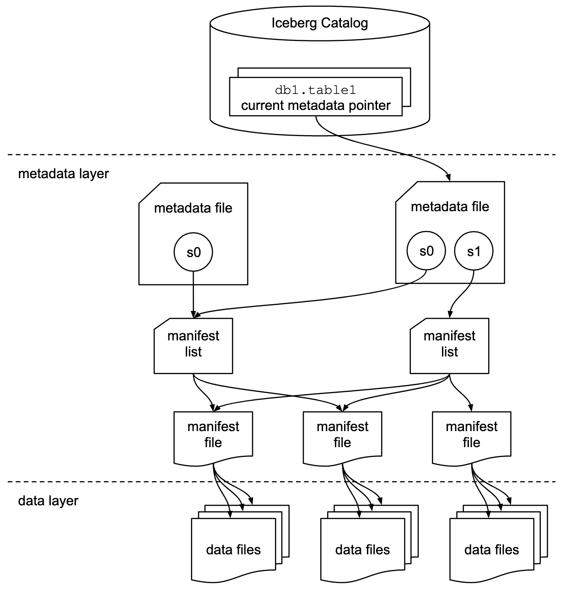

# レイクハウスの設計思想

<!-- doc-purpose:start -->
> **役割:** データの保存、品質、所有、AI利用の考え方をFoundation Rの実装と照らし合わせます。
>
> **対象読者:** 初めて使う人 / 基盤構築担当
>
> **読むタイミング:** 設計判断を理解するときや、用途に合わせて構成を変更するとき。
>
> **前提となる資料:** なし。必要な用語は本文で確認します。
>
> **次に読む資料:** [アーキテクチャと業務契約](<ARCHITECTURE.md>)
>
> **文書一覧:** [目的・読者から探す文書マニフェスト](<../DOCUMENTATION-MANIFEST.md>)
<!-- doc-purpose:end -->

## データレイクとウェアハウスから受け継いだもの

データレイクはCSV、JSONL、画像などをそのまま保管しやすく、将来の使い方が決まっていない原本も残せます。データウェアハウスは型、粒度、指標を定義した表を公開し、継続的に同じ意味で分析できるようにします。レイクハウスはオブジェクトストレージ上のファイルに表のメタデータとトランザクションを重ね、この2つの用途をつなぎます。Foundation Rでは同じ受注データから原本の再確認、異常行の調査、Goldの出荷率の確認ができます。[CIDRのレイクハウス原論文](https://15721.courses.cs.cmu.edu/spring2024/papers/01-modern/armbrust-cidr21.pdf)

## 設計で答える問い

| 問い | 考え方 | Foundation Rでの扱い |
| --- | --- | --- |
| データはどこに置き、どこで計算するか | ストレージと計算の分離。オブジェクトストレージを永続層に置き、読み書きは開いた仕様でつなぐ | SeaweedFSに原本とParquetを保管し、Iceberg RESTで表を見つけ、DuckDBを処理時に起動する。別エンジンを使う前に、表の形式・機能とカタログへの接続を検証する |
| どの行を分析に使えるか | メダリオン。原本から、取り込んだ行、検査済みの行、用途別の集計へ品質と意味を積み上げる | 原本はRaw。Bronzeで入力を取り込み、Silverで型とキーを検査する。代表エラーをQuarantineに残し、Goldに日次生産や出荷状況を公開する |
| 複数の表を同じ時点で読めるか | スナップショットと公開世代。表の版と利用者に公開する出力の組を記録する | Icebergのcommitは表単位。ワーカーが出力を保存した後に `gold._release` へ世代を登録し、APIはその世代に記録された表の版を読む |
| 数字の意味をどこで決めるか | DDDと分析の粒度。業務用語の意味を文脈ごとに定義し、指標の集計単位を先に決める | MESの指図・実績・停止をそのまま結ぶと行が増えるため、それぞれ工場×UTC日へ集計してから結合する。ERPの出荷は受注キーへ集計する |
| 誰が品質と利用条件を持つか | データメッシュ。ドメインがデータ製品を持ち、共通基盤のセルフサービスと連邦型ガバナンスで相互利用を支える | データ契約、出力の説明、読取APIをデータ製品の土台にする。ドメイン別の所有者、SLO、アクセス承認と連邦型ガバナンスは導入する組織で決める |
| 変更をどう取り込み、どうやり直すか | バッチとCDC。ファイルはまとまりで受け取り、DBの変更はイベントの順序と削除の意味を保存する | バッチは完了印とSHA-256で照合する。任意CDCはKafkaの配送記録とDBの変更順を区別する。どちらの経路も業務契約を通ってGoldへ到達する |
| 小さな部品をどうつなぐか | UNIXの責務分離。各部品に狭い役割を持たせ、明示したインターフェースで組み合わせる | 投入アプリ→ファイルと完了印、ワーカー→型と変換、API→利用者への公開、Prometheus→測定という境界を設ける |
| AIにどこまで任せるか | AIワークフローとエージェンティックメッシュ。ツールの権限、入力制約、根拠、実行の追跡性を定義する | LangChainに定義済みのGold読取ツールを提供する。AIは公開世代と表のスナップショットを参照できる。エージェント間の協調基盤は導入範囲に含まれない |

メダリオンはデータ品質の段階を、DDDは業務用語の境界を、データメッシュは所有と運用の分担を決めるときに使えます。同じ製造データに3つの考え方を適用できます。メダリオンの製品側の構成例はMicrosoftの図で確認できます。[メダリオン設計](https://learn.microsoft.com/en-us/azure/databricks/lakehouse/medallion/) · [Microsoft Fabricの公式構成図](https://learn.microsoft.com/en-us/azure/architecture/databases/architecture/dataops-mdw) · [データメッシュの原則](https://martinfowler.com/articles/data-mesh-principles.html) · [Kimballのディメンショナルモデリング](https://www.kimballgroup.com/data-warehouse-business-intelligence-resources/kimball-techniques/dimensional-modeling-techniques/)

## 品質、モデル、配信方式を決める

メダリオンを使う場合でも、表のモデルと処理の方式は用途ごとに決めます。
同じ製造イベントを原本の調査、設備の速報、確定した生産実績に利用する
例で考えます。

| 方式 | 先に決めること | 工場データでの使い方 |
| --- | --- | --- |
| Kimballのディメンショナルモデリング | 1行が表す測定事象、切り口、足し合わせられる数値 | 製造実績は指図・設備・日付を照合し、計画数と実績数が結合で増えないよう先に集計します。日次生産Goldの粒度は工場×UTC日です |
| Data Vault 2.0 | 業務キーのHub、関係のLink、属性や変更履歴のSatellite | 拠点・業務システムごとに品番の属性と履歴を独立して保持する候補です。標準は原本と個別の型付け表で対応し、長期の統合キーが必要になったときに評価します |
| Lambdaアーキテクチャ | 速報を出す経路と、まとめて再計算する経路の照合方法 | 設備速報の検索用時系列DBと、承認済みの原本・長期履歴を区別します。同じ指標を速報と確定に出す場合は計算規則と遅着の扱いを揃えます |
| Kappaアーキテクチャ | 再処理に必要なイベント履歴、順序、差し替えや削除の意味 | ブローカーの履歴を十分に保持できる経路で候補になります。CDCの隔離復元では確定済みRawの位置とNULLを照合し、履歴の欠けた区間は停止します |

[粒度を先に決めるKimballの手順](https://www.kimballgroup.com/data-warehouse-business-intelligence-resources/kimball-techniques/dimensional-modeling-techniques/four-4-step-design-process/)
· [Daniel LinstedtによるData Vault 2.0の解説](https://datavaultalliance.com/engineering/data-vault-2-0-an-introduction/)
· [LambdaとKappaの設計例](https://learn.microsoft.com/en-us/azure/architecture/databases/guide/big-data-architectures)
· [確定済みCDCを隔離で再生する手順](CDC-SHADOW.md)

## 工場内の責任とキーを合わせる

ISA-95／IEC 62264の考え方では、計測・制御、製造オペレーション、
経営計画・物流の間でやり取りする情報と責任を定めます。
Foundation Rでは、設備の値と品質、生産の指図・停止・実績、ERPの受注・出荷を
それぞれの契約で受け取り、取り込み担当と指標の所有者を決めます。
PLC・制御機器への書込を伴う運転制御は工場の既存の責任範囲です。
[ISAの概要](https://www.isa.org/standards-and-publications/isa-standards/isa-95-standard)
· [ISA-95の製造と業務システム間の情報交換プロファイル](https://www.isa.org/products/ansi-isa-95-00-08-2020-enterprise-control-system-i)

| 導入時に合意する項目 | 例 |
| --- | --- |
| 設備の論理IDと物理資産 | 温度センサーを交換しても製造ラインの論理設備IDを継続します。個体番号と交換時刻を別に記録すると、設備の集計と校正・保守の履歴を同時に追えます |
| 発生時刻、受信時刻、業務日 | 深夜シフトを一勤務として集計する場合は、工場のタイムゾーン、日付の帰属、日跨ぎ・夏時間をカレンダー契約に定めます。標準のUTC日と業務シフトの値はそれぞれの粒度で照合します |
| 名称、単位、品質 | 同じ名前の設備を工場とラインのIDで分け、温度の単位と品質コードを記録します。スケールや換算を変更する場合は、配備時刻と設定の版を保全します |
| 訂正、取消、遅着 | 出荷取消、同一計測の再送、設備時刻の誤りを区別します。原本と確定済みの公開世代を照合し、正しいデータ製品だけを再公開します |

[OPC UA ISA-95の論理設備と物理資産](https://reference.opcfoundation.org/specs/OPC-10030/8)
· [設備JSONLとソース契約](SOURCES.md)

## テーブル形式の選択

| 形式 | 設計上の特徴 | Foundation Rでの判断 |
| --- | --- | --- |
| Apache Iceberg | スナップショットとマニフェストで表の構成ファイルを管理する | 計算エンジンと独立して保存でき、PythonのPyIcebergとLakekeeperのRESTを使える。標準構成で新規作成する表は形式v2を指定する。[Iceberg仕様](https://iceberg.apache.org/spec/) |
| Delta Lake | トランザクションログで表を管理する。バッチとストリーミングの双方で使われる | 保守やガバナンスの比較対象。エンジンと表形式の対応機能はそれぞれの仕様を確認する。[Delta Lake公式文書](https://docs.delta.io/) |
| Apache Hudi | コミットのタイムラインを持ち、増分読取や更新の多いデータについて複数の表タイプを提供する | 更新頻度の高いワークロードを別途評価するときの候補。[Apache Hudi概要](https://hudi.apache.org/docs/overview/) |

### Iceberg公式仕様のスナップショット図

各スナップショットは、その時点で読み取るファイルの組を表します。Foundation Rの `gold._release` は、この仕組みを使い、各Gold表のスナップショットIDをまとめて記録します。古い公開世代を読みたい場合は、参照先のスナップショットとファイルも保存しておきます。[Foundation Rの公開手順](ARCHITECTURE.md#公開と失敗時の一貫性)

図はApache Iceberg公式仕様の「Iceberg snapshot structure」です。© The Apache Software Foundation。Apache License 2.0に従って原図を掲載します。[掲載元](https://iceberg.apache.org/spec/#overview) · [取得元の固定リビジョン](https://github.com/apache/iceberg/blob/c44bd8e7c183cf92339939f2aff5ca2aa2a0fd3d/site/docs/assets/images/iceberg-metadata.png) · [Apache License 2.0](images/iceberg-LICENSE.txt) · [上流NOTICE](images/iceberg-NOTICE.txt)

## 実際に使い始めるときの判断

- まず1台のVMで合成データを使い、業務契約と受入結果を揃えます。処理時間やデータ量が限界に達したら、外部エンジンからの相互運用と分散実行エンジンの利用を検証します。[データ量と構成の境界](ARCHITECTURE.md#公開と失敗時の一貫性)
- 表のキー、時刻の基準、単位、NULLと取消の扱いを先に決めます。集計の数値が想定と違うときは、Gold、Silver・Quarantine、原本の順に照合します。[入力の契約](SOURCES.md)
- AIをつなぐ場合は、出荷状況など目的を1つ選び、返却行数と読取範囲を限定します。回答の根拠として公開世代を保持し、誤答時に同じ世代のデータを再確認します。[Gold APIとLangChain](API.md)
- 復元の練習では、オブジェクト、カタログ、設定をセットで扱い、復元先から同じ公開世代を読めることを確認します。[運用、バックアップ、受入試験](OPERATIONS.md)

## 参考書籍

- Denny Leeほか『詳解 データレイクハウスアーキテクチャ』の1章と9章を表形式と配置設計の比較に、11〜13章をCDC、ガバナンス、リネージの確認に参照しました。このリポジトリの書込と読取の根拠はApache Icebergの仕様です。[オライリー・ジャパン](https://www.oreilly.co.jp/books/9784814401390/)
- Eric Broda、Davis Broda『エージェンティックメッシュ』の3章と5〜6章を、決定的な処理とAIの判断を分けること、ツールの最小権限、追跡性の説明に参照しました。[オライリー・ジャパン](https://www.oreilly.co.jp/books/9784814401758/)
