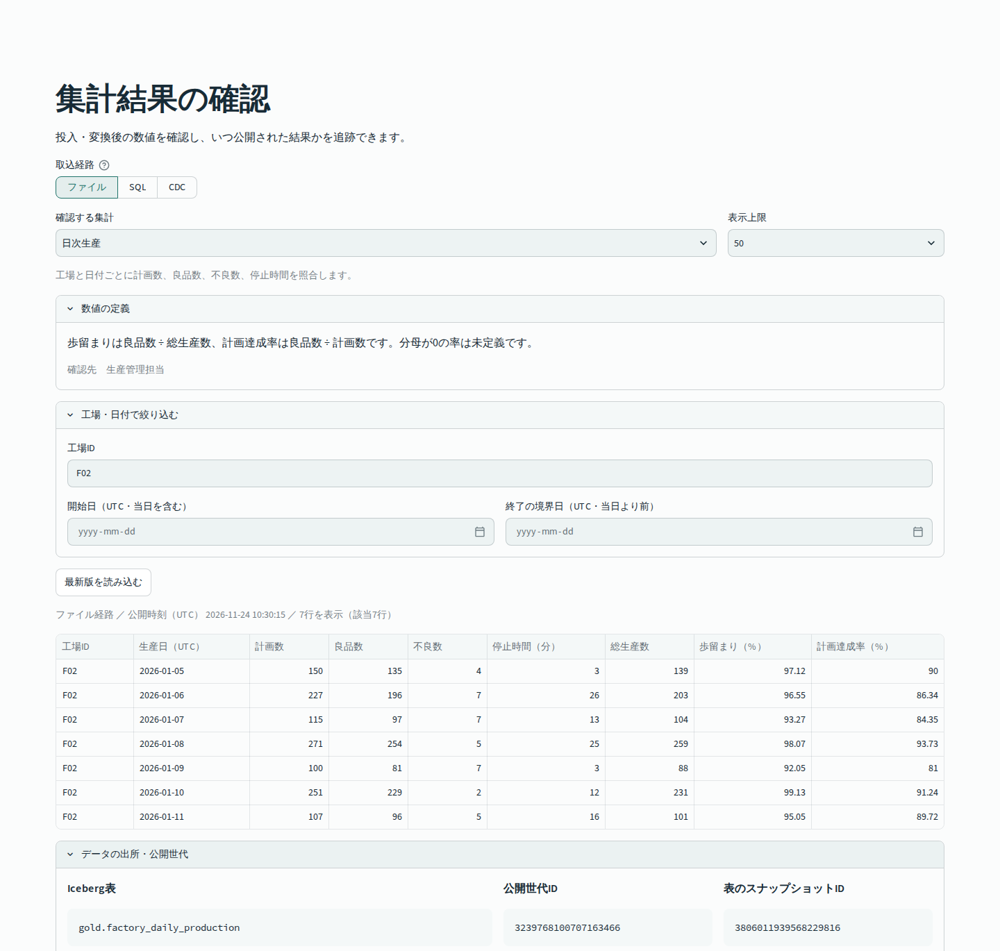

# データ閲覧と管理画面を追加する

<!-- doc-purpose:start -->
> **役割:** Gold・Lakekeeper・Prometheusの認証付き閲覧画面を用意します。
>
> **対象読者:** 初めて使う人 / 基盤構築担当
>
> **読むタイミング:** ブラウザーで実データと運用状態を確認するとき。
>
> **前提となる資料:** [Foundation Rの初回導入と操作](<START.md>)
>
> **次に読む資料:** [Grafanaの稼働監視を設定ファイルで管理する](<MONITORING.md>)
>
> **文書一覧:** [目的・読者から探す文書マニフェスト](<../DOCUMENTATION-MANIFEST.md>)
<!-- doc-purpose:end -->

任意の `compose.gui.yaml` を重ねると、ブラウザーでGold、カタログ、監視の詳細を確認できます。閲覧ゲートウェイはNGINXです。3画面とも同じBasic認証を使います。Grafanaと読取APIはそれぞれの認証を使います。

| ホスト上の既定URL | 画面 | できること |
| --- | --- | --- |
| `http://127.0.0.1:18503/` | Streamlit | 日次生産・受注出荷・設備最新値・設備1分集計の表、公開世代ID、Icebergの表スナップショット |
| `http://127.0.0.1:18504/ui/` | Lakekeeper | 名前空間・テーブルとカタログ情報の閲覧。ゲートウェイでは更新要求を拒否 |
| `http://127.0.0.1:18505/targets` | Prometheus | 監視対象、プローブの結果、メトリクスとアラート |
| `http://127.0.0.1:18501/d/lakehouse-r-runtime` | Grafana | 稼働監視のダッシュボード |
| `http://127.0.0.1:18502/health` | Lakehouse HTTP API | ワーカー状態。業務データのGETは読取トークンを要求 |

## 取り込み後に確認できること

投入と変換を終えたら、ブラウザーで日次生産・受注出荷・設備の集計を開き、対象行と数値が想定どおりかを確認します。例えば初回導入の合成データでは「日次生産」で2工場×7日、全14行を確認できます。

対象が多いときは **工場・設備・日付で絞り込む** を開きます。
工場IDと設備IDは、画面に表示されるデータのIDを入力します。
受注・出荷では受注IDと受注日の条件が使えます。終了の境界日より前の
行が対象なので、例えば1月5日だけを調べる場合は開始日を1月5日、
終了の境界日を1月6日にします。
絞り込みを変えても、**最新版を読み込む** までは同じ公開世代を使います。



同じブラウザーセッションで集計を切り替えると、最初に開いた公開世代の結果を表示します。再投入後の結果を確認するときは「最新版を読み込む」を押します。担当者に数値を問い合わせるときは「データの出所・公開世代」にある表名、公開世代IDと表のスナップショットIDを添えます。

| 確認する集計 | 確認の目安 |
| --- | --- |
| 日次生産 | 工場と生産日が揃っているか。計画数、良品数、不良数、停止時間が期待どおりか |
| 受注・出荷 | 出荷のない受注が残るか。未出荷数と遅延出荷数が想定と一致するか |
| 設備の最新値 | 測定値に続けて時刻と品質コードを確認。最新の値がBADの場合も表示される |
| 設備の1分集計 | 点数とGOODの点数を確認。平均・最小・最大はGOODのみを対象にする |

集計が見つからない場合は、対応する入力が揃っているかと、変換が完了しているかを確認します。表示上限を超える行は画面に出ないため、照合時は「全N行」も確認します。[初回導入](START.md) · [入出力契約](SOURCES.md)

## 起動と接続

1. [初回導入](START.md) に従って、checkout外に `site.env` と受け渡し先を作ります。
2. 受け渡し先の所有ユーザーで、NGINXから読み取れる権限0600のBasic認証ファイルを作ります。以下の例ではパスワードを画面に表示せず、SHA-512のcrypt形式で保存します。生成済みのファイルを維持したい場合は作成手順を再実行せず、同じファイルを使います。
3. `site.env` に `LAKEHOUSE_OPS_HTPASSWD` の絶対パスを設定します。ブラウザーから使うホスト名が `localhost` と異なる場合は `LAKEHOUSE_BROWSER_HOST`、Lakekeeperの接続先には `LAKEHOUSE_CATALOG_URL` を入力します。
4. Composeを2ファイル指定して起動し、上の表を開きます。別端末ではSSHポート転送を使うか、TLS終端を通して接続します。

**Bash**

```bash
site="$HOME/.config/lakehouse-foundation-r/site.env"
auth="$HOME/.config/lakehouse-foundation-r/htpasswd"
(
  umask 077
  set -o noclobber
  read -rsp "閲覧用のパスワード: " viewer_password
  printf '\n'
  test -n "$viewer_password" || exit 1
  hash=$(printf '%s\n' "$viewer_password" | openssl passwd -6 -stdin) || exit 1
  printf 'operator:%s\n' "$hash" > "$auth"
)
```

`site.env` の設定例です。TLSを終端する場合は、接続するブラウザーから見たホスト名とURLを入力します。

```dotenv
LAKEHOUSE_OPS_HTPASSWD=/absolute/private/htpasswd
LAKEHOUSE_BROWSER_HOST=localhost
LAKEHOUSE_CATALOG_URL=http://localhost:18504
```

**Bash / Zsh共通**

```bash
chmod -R a+rX native/gui native/monitoring
docker compose --env-file "$site" -f compose.yaml -f compose.gui.yaml config --quiet
docker compose --env-file "$site" -f compose.yaml -f compose.gui.yaml \
  up -d --build --wait --wait-timeout 180
```

Dokployからは [企業向け配置手順](COMPANY.md) のRun Commandに同じComposeファイルを指定します。配置設定でポートを変更した場合は、ブラウザー向けURLも併せて更新します。Streamlitからは内部APIへ読取トークンだけを渡します。Lakekeeper UIがPOSTで要求するAPI統計は読取操作なので、ゲートウェイで該当パスだけ中継します。[Lakekeeper管理APIの仕様](https://docs.lakekeeper.io/docs/latest/api/management/)S3、PostgreSQL、Blackboxの接続情報は [稼働監視](MONITORING.md) とCompose定義で管理します。

[Streamlit公式の表表示](https://docs.streamlit.io/develop/api-reference/data/st.dataframe) · [NGINXのBasic認証](https://nginx.org/en/docs/http/ngx_http_auth_basic_module.html)


## 計算を繰り返して確認する

同じGoldを別の担当者と調査するときは、承認済みの日次生産スナップショット
をmarimoに渡せます。工場ごとの日別グラフ・期間の歩留まりを確認でき、
入力SHA-256と公開世代を記録します。配備は専用プロジェクトで行い、
ブラウザー入口を認証で保護します。[Notebookの導入と合成データ](../../examples/marimo/README.md)
