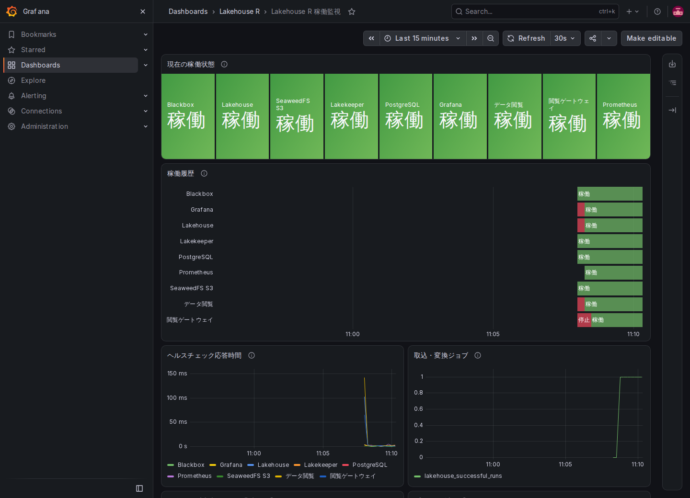

# Grafanaの稼働監視を設定ファイルで管理する

<!-- doc-purpose:start -->
> **役割:** PrometheusとGrafanaの監視対象・パネルを変更します。
>
> **対象読者:** 初めて使う人 / 基盤構築担当
>
> **読むタイミング:** 起動確認や監視対象の変更時。
>
> **前提となる資料:** なし。必要な用語は本文で確認します。
>
> **次に読む資料:** [運用、バックアップ、受入試験](<OPERATIONS.md>)
>
> **文書一覧:** [目的・読者から探す文書マニフェスト](<../DOCUMENTATION-MANIFEST.md>)
<!-- doc-purpose:end -->

標準起動で `Lakehouse R 稼働監視` がGrafanaに自動作成されます。サーバー自身から `http://localhost:18501/d/lakehouse-r-runtime` を開き、ユーザー名 `admin` とprivate `site.env` の `GRAFANA_ADMIN_PASSWORD` で入ります。初回パスワードはGrafanaデータvolumeが空のときに適用されます。



画像は [閲覧画面を追加](GUI.md) した構成です。標準構成は7対象、閲覧画面を追加すると9対象が表示されます。「サービスの状態」は緑の✓が正常、赤の×が異常です。履歴のバーにカーソルを合わせるとその区間の判定が表示されます。「取込・変換ジョブ」は成功と失敗を別の系列で表示します。「最終ジョブ成功からの経過時間」は調査の目安で、会社の実行間隔に応じたアラートは別途設定します。

| ファイル | 変更する内容 |
| --- | --- |
| [core.yml](../../native/monitoring/targets/core.yml) | PostgreSQL、SeaweedFS、Lakekeeper、Lakehouse、Prometheus、Grafana、Blackboxの監視先 |
| [gui.yml](../../native/monitoring/gui-targets/gui.yml) | 閲覧構成を追加した場合のStreamlitと閲覧ゲートウェイ |
| [blackbox.yml](../../native/monitoring/blackbox.yml) | HTTPステータスまたはTCP疎通の判定、タイムアウト |
| [prometheus.yml](../../native/monitoring/prometheus.yml) | scrape間隔、直接メトリクス、監視対象ファイルの場所 |
| [alerts.yml](../../native/monitoring/alerts.yml) | ダウンとジョブ失敗のPrometheusルール |
| [runtime.json](../../native/monitoring/dashboards/runtime.json) | パネル、配置、しきい値、PromQL |
| [lakehouse.yml](../../native/monitoring/provisioning/dashboards/lakehouse.yml) | Grafanaのダッシュボードの読み込み方 |
| [prometheus.yml](../../native/monitoring/provisioning/datasources/prometheus.yml) | Grafanaが読むPrometheusの接続先とUID |

## 監視先を追加する

稼働確認用HTTPエンドポイントがあるときは、`targets` にComposeから到達できるURL、`app` に重複しない表示名、`module` に `http_ready` を指定します。TCPだけの場合は `hostname:port` と `tcp_connect` を指定します。監視コンテナの `127.0.0.1` は監視コンテナ自身です。別VMや別Composeの投入アプリでは、監視用ネットワークと実URLを管理者が確定してください。

```yaml
- targets: [http://injector.example.invalid:8080/healthz]
  labels: {app: Factory File Generator, module: http_ready}
```

任意のnative CDCを起動した環境では `native-cdc:8001` をTCPターゲットとして登録できます。処理遅延や配送完了は、認証付きconsumer statusとIceberg結果で別途確認します。緑の✓は監視先への疎通確認です。DB/S3のTCPチェックはポート到達性、HTTPは該当ヘルスの2xxを示します。DB移行の成功はLakekeeperの起動条件です。TLS経由の社外利用体験、実データ品質、バックアップ成功はそれぞれの検査で確認します。

## 反映する

ローカルで既存の `targets/*.yml` やダッシュボードJSONを編集すると、Prometheusのfile discoveryとGrafanaのポーリングで概ね30秒程度で反映します。Provisioning YAML、Prometheus本体設定、アラート、Blackbox設定を変更した場合は該当コンテナを再作成します。

**Bash / Zsh共通**

```bash
docker compose --env-file "$site" up -d --force-recreate blackbox prometheus grafana
docker compose --env-file "$site" exec -T prometheus \
  promtool check config /etc/prometheus/prometheus.yml
docker compose --env-file "$site" exec -T blackbox \
  /bin/blackbox_exporter --config.file=/etc/blackbox/blackbox.yml --config.check
```

Dokployでは変更をGitへ保存し、対象Composeを再配備します。公開設定はビルド時に読み取り権限を固定してイメージへ組み込みます。Dokployの標準Deployはビルドも実行します。[Advanced → Run Command](COMPANY.md) でカスタムコマンドを使う場合も `--build` を含め、Grafana・Prometheus・Blackboxがhealthyになったことを確認します。GrafanaのUIで試作したパネルはClassic JSONへexportし、`runtime.json` を更新します。配布したダッシュボードは `uid` を維持し、起動時にファイルからプロビジョニングします。GrafanaのUIからの永続上書きは無効です。通知を配信する場合は、Prometheusのルールに接続するAlertmanagerを導入先で設定します。

[Grafana公式Provisioning](https://grafana.com/docs/grafana/latest/administration/provisioning/) · [Prometheus file discovery](https://prometheus.io/docs/prometheus/latest/configuration/configuration/#file_sd_config) · [Blackbox Exporterの設定パターン](https://prometheus.io/docs/guides/multi-target-exporter/)
