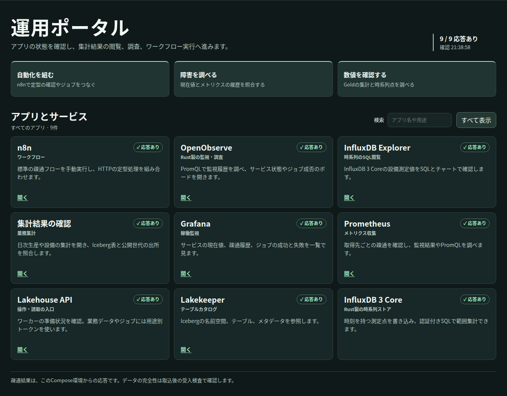
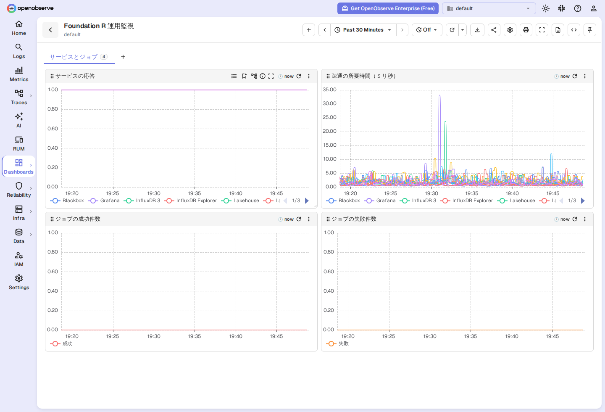

# 運用ポータルと追加ツール

<!-- doc-purpose:start -->
> **役割:** n8n、OpenObserve、InfluxDBの設置と初回操作を確認します。
>
> **対象読者:** 基盤構築担当 / 運用担当
>
> **読むタイミング:** 運用自動化、監視調査、設備時系列を追加するとき。
>
> **前提となる資料:** なし。必要な用語は本文で確認します。
>
> **次に読む資料:** [運用、バックアップ、受入試験](<OPERATIONS.md>)
>
> **文書一覧:** [目的・読者から探す文書マニフェスト](<../DOCUMENTATION-MANIFEST.md>)
<!-- doc-purpose:end -->

[標準構成](START.md) の運用を始めた後、同じComposeプロジェクトに追加できます。管理画面は運用者向けです。会社VMではTLS終端またはSSH転送を用意し、Composeの公開ポートはループバックへ限定します。

| アプリ | 何に使うか | ホスト上の既定URL |
| --- | --- | --- |
| 運用ポータル | 疎通状況、作業別の入口、説明スライドを開く | `http://localhost:18506/` |
| n8n | 手動実行やイベントから定型手順をつなぐ。ワークフローをJSONで管理 | `http://localhost:18507/` |
| OpenObserve | Rust製の観測基盤。取り込んだPrometheusの監視履歴をPromQLで調査 | `http://localhost:18508/` |
| InfluxDB 3 Explorer | 保存した測定点をSQLで検索し、表やチャートで確認 | `http://localhost:18509/` |
| InfluxDB 3 Core | Rust製の時系列DB。Line Protocolで受信し、DataFusionによるSQLを提供 | `http://localhost:18510`（API） |

n8nの永続状態は専用PostgreSQLに分離します。InfluxDBの測定点は時系列の調査用データです。業務集計の公開範囲と版はIcebergのGoldで管理します。n8n CommunityとInfluxDB 3 Explorerは独自の利用条件があるため、会社で有効にする前に採用版の契約を確認します。[各コンポーネントの配布条件](REFERENCES.md#追加機能の配布条件) · [InfluxDB 3 Core](https://docs.influxdata.com/influxdb3/core/)

n8nから見える `lakehouse:8080` は、許可した読取GET専用のゲートウェイです。付属フローの `/health` はそのまま使えます。Goldの取得には読取トークンが必要です。書込ジョブの `POST /run` は、VMのループバック側から操作トークンで実行します。



## 起動する

DockerとOpenSSLを使います。配備先VMで追加ツールの秘密ファイルを初回だけ生成します。閲覧を併用するときは [GUIの認証](GUI.md) も準備します。

**Bash / Zsh共通**

```bash
site="$HOME/.config/lakehouse-foundation-r/site.env"
tools="$HOME/.config/lakehouse-foundation-r/tools"
python3 native/tools/setup.py --directory "$tools"
```

Dokployでは `tools.env` の内容を同じComposeの **Environment** へ登録します。[会社VMの追加構成](COMPANY.md#追加のcompose構成を有効にする) に従い、**Run Command** に `-f compose.tools.yaml` を追加してDeployを実行します。閲覧も使う場合は `-f compose.gui.yaml` をその手前に置きます。初回にOpenObserveを設定するまでは転送用プロファイルを指定しません。

端末から直接Composeを起動する専用の検証環境では、`project` を同じプロジェクト名に統一します。初回と再起動で同じComposeファイルを指定します。

**Bash / Zsh共通**

```bash
project="lakehouse-r"
docker compose -p "$project" --env-file "$site" --env-file "$tools/tools.env" \
  -f compose.yaml -f compose.tools.yaml config --quiet
docker compose -p "$project" --env-file "$site" --env-file "$tools/tools.env" \
  -f compose.yaml -f compose.tools.yaml up -d --build --wait --wait-timeout 240
```

ポータルは `http://localhost:18506/` です。`operator.json` に記録された専用アカウントを使います。n8nとExplorerの入口でも同じ認証が必要です。n8nの初回画面で管理者を登録します。OpenObserveは `tools.env` の `TOOLS_OBSERVE_USER` と `TOOLS_OBSERVE_PASSWORD` を使います。

ホストのポートは `TOOLS_PORT`、`TOOLS_N8N_PORT`、`TOOLS_OBSERVE_PORT`、`TOOLS_EXPLORER_PORT`、`TOOLS_INFLUX_PORT` で変更できます。OpenObserveの準備・検査とInfluxDBの合成入力のCLIには、変更後のポートを `--port` で渡します。ポータルの接続先URLは、開いているホスト名と構成で指定したポートを使います。n8nをHTTPSで使う場合は `TOOLS_N8N_URL` を実際のHTTPS URLへ設定し、`TOOLS_SECURE_COOKIES=true` にします。リバースプロキシの段数は `TOOLS_N8N_PROXY_HOPS` で指定します。[Dokployの配置手順](COMPANY.md) · [n8nのリバースプロキシ](https://docs.n8n.io/deploy/host-n8n/configure-n8n/basic-configuration/configuration-examples/configure-webhook-urls-with-reverse-proxy)

## ワークフローを手動実行する

1. n8nの画面でワークフローを作り、メニューの **Import from File** から [疎通確認のJSON](../../native/tools/health-workflow.json) を選択します。
2. **Execute workflow** を押し、最後のステップで `ready: true` と `blocked: false` を確認します。フローには内部APIのヘルス確認だけが含まれます。
3. 日程実行を追加する場合は、用途別の認証と権限を決め、試験環境で同じ処理が再実行される場合を確認します。

付属のフローは未公開のまま手動実行できます。HTTPノードは
`GET /health` として状態を確認します。取込や定期実行、外部通知が
必要な場合は用途ごとのワークフローを定義します。
[n8nのファイルインポート](https://docs.n8n.io/build/manage-workflows/export-and-import.md)


## OpenObserveに監視メトリクスを送る

初回のprovisionは転送用パスコードを `observe-passcode` に0600で保存し、[4パネルのダッシュボード](../../native/tools/openobserve-dashboard.json) を登録します。次に転送サービスを起動します。既存の同名ボードは維持します。既存の設定を変更するときは、画面で編集する前にJSONをエクスポートして保存します。リポジトリの設定を別ボードとして試すには、JSONのタイトルを変え、**Dashboards → Import → Custom** から読み込みます。

**Bash / Zsh共通**

```bash
python3 -m native.tools.observe provision --directory "$tools"
```

Dokployでは **Run Command** に `--profile tools-metrics` を `up` の前に追加し、同じComposeを再配備します。端末から直接起動した検証環境では、同じ `project`・環境ファイル・追加Composeファイルで転送を有効にします。

**Bash / Zsh共通**

```bash
docker compose -p "$project" --env-file "$site" --env-file "$tools/tools.env" \
  -f compose.yaml -f compose.tools.yaml --profile tools-metrics up -d --wait
```

Dokployの **Docker → Containers** に表示される `observe-forwarder` が
healthyになると、転送用Agentの受付準備が完了しています。
OpenObserveへの到着は受信側で確認します。
[Prometheusのreadiness](https://prometheus.io/docs/prometheus/latest/management_api/#readiness-check)

1分ほど経ってからOpenObserveにログインし、**Dashboards → Foundation R 運用監視** を開きます。4パネルで、アプリ別の応答と所要時間、ジョブの成功件数、失敗件数を調べられます。



「サービスの応答」の1は期待したHTTP応答、0は疎通失敗です。同じアプリに複数の監視先がある場合は、失敗を見落とさないよう最小値を表示します。所要時間はアプリごとの最大値をミリ秒に換算します。凡例で表示するアプリを切り替えられます。系列がない場合は、画面の期間とRefresh、対象登録と転送を順に確認します。

**Bash / Zsh共通**

```bash
python3 -m native.tools.observe verify --directory "$tools"
```

採取対象は [targets.yml](../../native/tools/targets.yml) を編集します。Grafana側の編集は [監視設定](MONITORING.md) を参照してください。[Prometheus remote write](https://openobserve.ai/docs/ingestion/metrics/prometheus/) · [OpenObserveのインポート](https://openobserve.ai/docs/user-guide/analytics/dashboards/dashboards-in-openobserve/) · [OpenObserve 1.1.2の192列レイアウト](https://github.com/openobserve/openobserve/blob/v1.1.2/web/src/views/Dashboards/RenderDashboardCharts.vue#L865-L870)

## 設備の合成測定点を確認する

**Bash / Zsh共通**

```bash
python3 -m native.tools.demo --token-file "$tools/influx-admin.json"
```

結果に `foundation_demo` と `points: 3` が表示されます。Explorerを初めて開くと利用条件の確認画面が表示されます。利用条件を読み、利用状況の送信設定を会社の方針に合わせて選んでください。設定画面の **Add Server** でDocker内部URL `http://influxdb3:8181` と `influx-admin.json` の `token` を登録します。データベース `foundation_demo` を選び、次のSQLで値を確認します。

```sql
SELECT time, device, celsius
FROM temperature
ORDER BY time DESC
LIMIT 3;
```

Explorerはクエリモードで動かします。使用するInfluxDB Coreのトークンには管理権限があります。接続登録と閲覧を許可された運用者の作業環境として運用してください。会社の設備データを送る前に、保持期間・バックアップとリストア・API認証を受け入れます。[InfluxDB Explorerの接続手順](https://docs.influxdata.com/influxdb3/explorer/get-started/) · [管理トークン](https://docs.influxdata.com/influxdb3/core/admin/tokens/)
