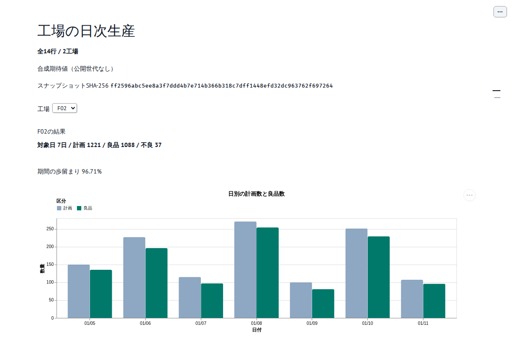

# 日次生産Goldをmarimoで再現する

<!-- doc-purpose:start -->
> **役割:** 承認済みのGoldを別環境で確認し、工場別の日次生産と歩留まりを再集計します。
>
> **対象読者:** データ利用担当 / 基盤構築担当
>
> **読むタイミング:** 入力のハッシュと公開世代を固定し、調査を他の担当者と再現するとき。
>
> **前提となる資料:** [認証付きAPIとLangChain](<../../docs/native/API.md>)
>
> **次に読む資料:** [データ閲覧と管理画面を追加する](<../../docs/native/GUI.md>) / [会社VMの受入手順と合格条件](<../../docs/native/ACCEPTANCE.md>)
>
> **文書一覧:** [目的・読者から探す文書マニフェスト](<../../docs/DOCUMENTATION-MANIFEST.md>)
<!-- doc-purpose:end -->

Foundation Rで公開した日次生産の小さなスナップショットを、別のNotebookに
渡して同じ条件で集計します。工場を選ぶと計画、良品・不良、期間の歩留まりを
切り替え、日別の計画と良品をグラフで確認できます。別の担当者には
SHA-256と公開世代を伝えると、同じ入力で
集計を再実行できます。歩留まりは良品数の合計を生産数の合計で割ります。



## 合成データで試す

Docker EngineとDocker Composeが動くLinux端末で、checkoutの `examples/marimo` に移動して実行します。以下の
`oracle` はFoundation Rのコミット済み `medallion/expected-demo.json`、
`approved` はこのComposeにだけ割り当てる新規ディレクトリです。
既にあるFoundation RのComposeプロジェクトとは別名を使います。

**Bash / Zsh共通**

```bash
oracle=/absolute/path/to/lakehouse-foundation-R/medallion/expected-demo.json
approved="$PWD/approved"
project=foundation-r-marimo-demo
umask 077
python3 make_fixture.py "$oracle" "$approved"
openssl rand -hex 32 > "$approved/token"
printf 'MARIMO_APPROVED_DIR=%s\nMARIMO_UID=%s\nMARIMO_GID=%s\n' \
  "$approved" "$(id -u)" "$(id -g)" > site.env
docker compose --env-file site.env -p "$project" config --quiet
docker compose --env-file site.env -p "$project" up -d --wait
docker compose --env-file site.env -p "$project" port gateway 8080
```

端末に表示された `127.0.0.1:<ポート>` をブラウザーで開き、`approved/token`
の値を入力します。接続元が別の端末なら、許可されたSSHトンネルでポートを
転送します。合成期待値では「全14行 / 2工場」、各工場は7日です。
合成期待値には実際のIceberg公開世代がないため、画面にもその旨を表示します。

**Bash / Zsh共通**

```bash
docker compose --env-file site.env -p "$project" exec -T notebook \
  python /work/smoke_schema.py
docker compose --env-file site.env -p "$project" down
```

ブラウザー操作の再検証は、検証端末のPlaywright 1.65.2とChromiumで
`python browser_smoke.py http://127.0.0.1:<ポート> approved/token screenshot.png`
を実行します。画面はローカルの認証フォームとWebSocketを使います。
検証端末の既存Chromiumを使う場合は `--chromium-executable` にそのパスを指定できます。

## 承認されたGoldへ切り替える

Foundation Rの管理者が承認した範囲の
`GET /v1/gold/factory_daily_production?limit=200&release=<公開世代ID>`
の応答を、`gold.json` として専用領域へ保存します。読み取りトークンは
この取得作業でだけ使います。対象の内容と公開世代を承認した担当者が
保存後のSHA-256を計算し、別ファイル `approval.json` を次の形で作ります。

```json
{"format_version":1,"source":"foundation_gold_api","sha256":"<64桁の小文字16進数>"}
```

`gold.json`、`approval.json` とNotebook用の `token` は、配備担当者が管理
するアクセス制限付きディレクトリへ保存します。SHA-256は、管理者が
承認ファイルを保護した状態で内容の一致を照合するためのものです。
署名や利用者別の権限管理は配備側で行います。応答が未公開・空・途中までの
場合、または日次生産の対象外の場合は読み込みを中断します。200行を超える
対象は、この受入用アダプターの対象外です。

## アクセスとネットワーク

NotebookソースとGoldは読み取り専用マウントです。公式イメージの既定CMDを
`marimo run` で上書きし、トークン認証を有効にします。公開する入口は
Dockerが割り当てたループバックポート1つです。Notebookは外部接続のない内部ネットワークに置き、
別のNGINXサービスがホストのループバックへ中継します。更新確認も無効化します。
DuckDBはメモリー内で起動し、外部アクセスを無効化します。社内HTTPSで使う
場合は管理者が専用ゲートウェイに限定公開し、接続のTLS終端とWebSocket中継を
確認してください。

[marimoのDocker配置](https://docs.marimo.io/guides/deploying/deploying_docker/)
· [認証方法](https://docs.marimo.io/guides/deploying/authentication/)
· [Composeの内部ネットワーク](https://docs.docker.com/compose/how-tos/networking/)
