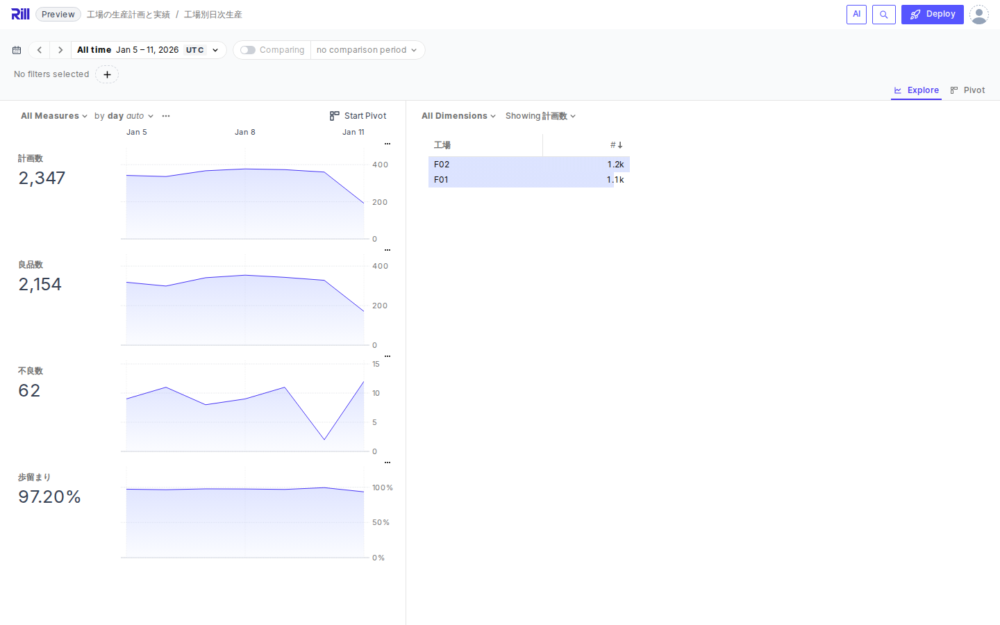

# Rillで工場別の日次生産を探索する

<!-- doc-purpose:start -->
> **役割:** 承認した日次生産Goldから、工場と期間を切り替えてKPIを確認します。
>
> **対象読者:** データ利用担当 / 基盤構築担当
>
> **読むタイミング:** 計画、実績、歩留まりを工場と日付で探索するとき。
>
> **前提となる資料:** [日次生産Goldをmarimoで再現する](<../marimo/README.md>)
>
> **次に読む資料:** [データ閲覧と管理画面を追加する](<../../docs/native/GUI.md>)
>
> **文書一覧:** [目的・読者から探す文書マニフェスト](<../../docs/DOCUMENTATION-MANIFEST.md>)
<!-- doc-purpose:end -->

承認した日次生産Goldを、工場と期間で絞り込んで比較します。計画数、良品数、
不良数、歩留まりの定義はYAMLに保存します。歩留まりは良品合計÷生産合計です。



## 検証用に起動する

公式RillイメージはLinux amd64です。[marimoの手順](../marimo/README.md) で作った承認ディレクトリと
Gold検証コードを準備します。認証はこの検証専用のパスワードを使います。
次の例は、このファイルのあるディレクトリから実行します。

**Bash / Zsh共通**

```bash
approved=/absolute/path/to/approved
adapter=/absolute/path/to/marimo/notebook
project=foundation-r-rill-demo
image=ghcr.io/marimo-team/marimo:0.25.2-sql@sha256:f154a40fba17cda7581edd3a3ef6c371d46c69a0e45dcd825293554e5d62e4c6
mkdir -p project/data project/tmp
chmod -R a+rX project analytics.yaml
docker run --rm --network none --cap-drop ALL \
  --security-opt no-new-privileges --user "$(id -u):$(id -g)" \
  --mount "type=bind,src=$PWD/prepare_duckdb.py,dst=/prepare.py,ro" \
  --mount "type=bind,src=$adapter,dst=/adapter,ro" \
  --mount "type=bind,src=$approved,dst=/approved,ro" \
  --mount "type=bind,src=$PWD/project/data,dst=/output" \
  -e PYTHONPATH=/adapter -e PYTHONDONTWRITEBYTECODE=1 \
  --entrypoint python "$image" /prepare.py

umask 077
mkdir -m 700 private
openssl rand -hex 32 > private/password
{ printf 'operator:'; openssl passwd -6 -stdin < private/password; } > private/htpasswd
printf 'RILL_PASSWORD_FILE=%s\nRILL_GATEWAY_UID=%s\nRILL_GATEWAY_GID=%s\n' \
  "$PWD/private/htpasswd" "$(id -u)" "$(id -g)" > site.env
docker compose --env-file site.env -p "$project" config --quiet
docker compose --env-file site.env -p "$project" up -d --wait
docker compose --env-file site.env -p "$project" port gateway 8080
```

表示されたループバックポートの `/explore/factory_explore` を開き、
ユーザー名 `operator` と `private/password` の値を入力します。別端末からは
許可されたSSHトンネルを使います。固定合成入力では2工場の日別指標が表示されます。

**Bash / Zsh共通**

```bash
docker compose --env-file site.env -p "$project" exec -T rill \
  rill query --local --connector gold_snapshot --format json \
  --sql 'SELECT count(*) AS rows, count(DISTINCT factory_id) AS factories FROM production'
docker compose --env-file site.env -p "$project" down
```

期待値は14行、2工場です。検証端末にPlaywright 1.65.2とChromiumがある場合は
`python browser_smoke.py http://127.0.0.1:<ポート> private/password screenshot.png`
で画面と認証を再検査します。

## 取り込むデータを固定する理由

準備コマンドが承認SHA-256と日次Goldのスキーマを照合し、DDLを通ったデータだけを
新規DuckDBファイルに書き出します。Rillは `mode: read` と読み取り専用マウントで
参照します。既定のローカルモデル実行は、この版ではクラウドの資格情報を探す
DuckDB拡張も初期化するため、隔離環境では事前に作成したDBを使います。

Rill DeveloperのPreviewを内部ネットワークで動かし、入口をNGINXのBasic認証で
保護します。gRPCは公開しません。匿名分析は無効にし、NGINXがブラウザーに
同一originの資産だけを許可します。オフラインでは上流CLIの新バージョン確認が
失敗する旨がログやCLIのJSON直前に出ます。隔離版のGit情報とクラウド
配備欄はデータ源がなく、管理用リクエストはエラーになります。KPI表示は
引き続き使えます。採用バージョンの更新は管理者が確認します。

[公式DuckDBコネクター](https://docs.rilldata.com/developers/build/connectors/olap/duckdb)
· [Rill Developerのプレビュー](https://docs.rilldata.com/developers/build/getting-started)
· [Rill Explore設定](https://docs.rilldata.com/developers/build/dashboards/explore)
